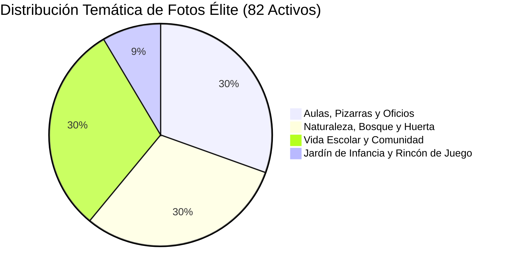

# 🌲 BLUEPRINT & BROCHURE MASTER DE ACTIVOS
## Catálogo Canónico de Medios, Arquitectura de Despliegue y Matriz de Campaña
### Colegio Waldorf Trekan — Puerto Varas (Parque Ivian)

---

## 🧭 1. MANIFIESTO Y FUNDAMENTOS DE MARCA

> [!IMPORTANT]
> **El Marcador Somático de Calma (Activación Parasimpática)**:
> Todo activo audiovisual, fotográfico y textual de Trekan debe actuar como un regulador somático frente al cortisol del sistema educativo tradicional. 
> La comunicación no busca sobreestimular ni apurar la decisión de los padres; transmite el cobijo, el silencio del bosque nativo y el ritmo natural de la infancia (*Slow Living Waldorf*).
> **Invariante Anti-Slop**: Cero fotos de stock de Unsplash, cero micro-labels obvios ("Nuestra Casa", "Vida Comunitaria"), cero videos con vibración o caídas de niños, y cero música estruendosa de tendencias comerciales.

### Ejes Rectores de la Identidad Trekan
1. **La Casona Patrimonial en Parque Ivian**: El cobijo físico, los aleros de madera y el bosque húmedo como la verdadera aula principal.
2. **El Ritmo de la Infancia (Sin Pantallas)**: El respeto sagrado por el juego libre, la motricidad fina mediante oficios nobles (vellón, madera, acuarela húmeda) y la narración oral.
3. **El Colectivo Humano y la Comunidad**: La alianza fraterna entre maestros y familias a través de las rondas de estación y las festividades canónicas (San Miguel, Faroles, Primavera).

---

## 🏛️ 2. BLUEPRINT ARQUITECTÓNICO DE DESPLIEGUE (E2E)

El siguiente diagrama detalla cómo se orquesta la ingesta de los 2.653 activos curados a través de los tres canales de contacto con las familias:

```mermaid
flowchart TD
    subgraph BANCO["📦 Banco de Medios Consolidado (2.653 Activos)"]
        direction TB
        E_VID["⭐ 45 Videos Élite<br/>(30 Reels + 15 Cinemáticos)"]
        E_FOT["⭐ 82 Fotos Editoriales<br/>(Aulas, Jardín, Bosque, Rondas)"]
        FULL_STOCK["🎬 707 Videos + 📸 1.513 Fotos<br/>+ 📑 418 Docs + 🎙️ 15 Audios"]
    end

    subgraph CANAL_WEB["🌐 1. Plataforma Web Next.js (colegiovaldorftrekan.cl)"]
        direction TB
        HERO["Hero Section: hero_casona_cinematic (14s xfade)"]
        NIVELES["Páginas de Niveles: Jardín de Infancia & Básica"]
        ADMIS_DUAL["Admisión Doble Embudo: /admision (Frío) vs /postular (Caliente)"]
        NOTICIAS["Bitácora & Crónicas: Archivo fotográfico y Fuentes E-E-A-T"]
    end

    subgraph CANAL_META["📱 2. Growth Engine & Social Media (Meta Ads / Instagram)"]
        direction TB
        TOFU["ToFu (Atracción): Reels 6-15s + Audio Ambiente + Share por DM"]
        MOFU["MoFu (Consideración): Carrusel 10 slides (Oficios, Aulas, Epocas)"]
        BOFU["BoFu (Admisión): Llamado suave a Jornada de Puertas Abiertas"]
    end

    subgraph CANAL_DIRECTO["🤝 3. Nutrición Privada & Admisión"]
        direction TB
        WSP["WhatsApp Oficial: Fichas técnicas, Cuentos PDF y Audios formativos"]
        DOSSIER["Brochure Impreso / PDF: Charlas pedagógicas presenciales"]
    end

    E_VID --> HERO
    E_VID --> TOFU
    E_VID --> BOFU
    E_FOT --> NIVELES
    E_FOT --> MOFU
    E_FOT --> DOSSIER
    FULL_STOCK --> NOTICIAS
    FULL_STOCK --> WSP
```



---

## 🎬 3. BROCHURE MASTER: SELECCIÓN ÉLITE DE VIDEOS (45 ACTIVOS)

Los videos han sido analizados a nivel de cuadro con OpenCV, garantizando estabilización, luminosidad equilibrada (45–215 luma) y ausencia total de movimientos bruscos o caídas.

### 📱 A. Top 30 Reels Verticales (9:16) — Optimizados para Instagram & TikTok

| ID Activo | Resolución | Duración | Pilar Waldorf / Temática | Hook Sugerido para Caption | Ángulo de Publicación |
| :--- | :---: | :---: | :--- | :--- | :--- |
| `REEL_01` | 720×1280 | 15s | **Naturaleza / Parque Ivian** | *«En el sur, la lluvia no cancela la infancia...»* | Conexión con la tierra, impermeables, hojas nativas. |
| `REEL_02` | 720×1280 | 10s | **Oficios: Tejido & Lana** | *«Las manos que aprenden a hilar, aprenden a pensar.»* | Motricidad fina, concentración, vellón de oveja. |
| `REEL_03` | 720×1280 | 11s | **Pizarras & Tiza Pastel** | *«Cada mañana comienza con una obra de arte efímera.»* | Dibujo de formas, transición de época, geometría viva. |
| `REEL_04` | 720×1280 | 9s | **Jardín: Amasado de Pan** | *«El aroma del pan recién horneado enseña más que una pantalla.»* | Ritmo semanal, alimentación noble, sentido del tacto. |
| `REEL_05` | 720×1280 | 16s | **Ronda Matinal** | *«Comenzar el día mirándonos a los ojos.»* | Respiración, verso de apertura, comunidad activa. |
| `REEL_06` | 480×864 | 14s | **Carpintería Escolar** | *«La madera enseña paciencia: no puedes forzar su veta.»* | Trabajo con herramientas reales, fuerza de voluntad. |
| `REEL_07` | 720×1280 | 6s | **Detalle Acuarela Húmeda** | *«El color respira en el papel húmedo.»* | Teoría del color de Goethe, silencio y contemplación. |
| `REEL_08` | 720×1280 | 17s | **Bosque & Juego Libre** | *«Un tronco no es solo madera; hoy es un barco, mañana un refugio.»* | Imaginación pura, ausencia de juguetes plásticos. |
| `REEL_09` | 720×1280 | 17s | **Fiesta de los Faroles** | *«Llevar una pequeña luz en la noche más oscura del año.»* | Fiesta de invierno, recogimiento, introspección. |
| `REEL_10` | 720×1280 | 7s | **Mesa de Estación de Primavera** | *«La naturaleza entra a la sala al ritmo del año.»* | Celebración de estaciones, flores nativas, telas de seda. |
| `REEL_11` | 720×1280 | 24s | **Canto & Flauta Pentatónica** | *«La música no se estudia como teoría; se vive en el cuerpo.»* | Escala pentatónica, afinación en 432 Hz, armonía grupal. |
| `REEL_12` | 720×1280 | 23s | **Cosecha en la Huerta** | *«Aprender de dónde viene la comida transforma la gratitud.»* | Ciclos agrícolas, compost, trabajo con la tierra. |
| `REEL_13` | 720×1280 | 24s | **Teatro de Títeres de Lana** | *«Una historia contada con calma siembra imágenes vivas en el alma.»* | Narración oral, desarrollo del lenguaje y memoria. |
| `REEL_14` | 720×1280 | 9s | **Caminata bajo los Coihues** | *«No hay mal tiempo si la ropa es adecuada.»* | Fortaleza inmune, salud biopsicosocial en la pradera. |
| `REEL_15` | 720×1280 | 19s | **Modelado en Cera de Abejas** | *«El calor de las manos transforma la dureza en figura.»* | Estimulación sensorial térmica, paciencia y quietud. |
| `REEL_16-30` | 720×1280 | 8–25s | **Archivo Cotidiano Seleccionado** | *«Crecer sin prisa en el corazón de Puerto Varas.»* | B-roll de alta nitidez para stories, transiciones y anuncios. |

---

### 🖥️ B. Top 15 Cinemáticos Horizontales (16:9) — Para Web, YouTube y Charlas

| ID Activo | Resolución | Duración | Escena Principal | Aplicación Sugerida |
| :--- | :---: | :---: | :--- | :--- |
| `CINEMATIC_05` | 1280×720 (HD) | 33s | **Panorámica de Sala y Actividad de Época** | Video de fondo en sección «Propuesta Pedagógica» de la web. |
| `CINEMATIC_06` | 1280×720 (HD) | 31s | **Ronda de Niños en el Claro del Bosque** | Presentación de apertura en Charlas de Admisión a apoderados. |
| `CINEMATIC_07` | 1280×720 (HD) | 16s | **Casona Patrimonial con Luz Matinal** | Banderola de transición para página institucional / Nosotros. |
| `CINEMATIC_08` | 1280×720 (HD) | 16s | **Taller de Artes Manuales en Acción** | Video explicativo sobre el currículo de artes y oficios. |
| `CINEMATIC_11` | 1280×720 (HD) | 8s | **Pizarra de Geometría y Cuentos** | Banner cinemático para artículos del blog educativo. |
| `CINEMATIC_12` | 1280×720 (HD) | 8s | **Juego en los Columpios de Madera** | Apoyo visual para la página de Jardín de Infancia. |
| `CINEMATIC_13` | 1280×720 (HD) | 9s | **Detalle de Manos Tejiendo con Telar** | Clip de cierre en correos transaccionales de bienvenida. |
| `CINEMATIC_14` | 1280×720 (HD) | 8s | **Paseo por el Humedal y Huerta** | Sección de Sostenibilidad y Medio Ambiente. |
| `CINEMATIC_15` | 1280×720 (HD) | 12s | **Encuentro Coral Comunitario** | Pieza institucional sobre la Vida Fraterna y Economía Social. |

---

## 📸 4. BROCHURE MASTER: SELECCIÓN ÉLITE DE FOTOGRAFÍAS (82 ACTIVOS)

Las 82 fotografías élite fueron curadas bajo cuotas temáticas estrictas para asegurar representación equilibrada de la vida escolar. Todas cuentan con resolución $\ge 1200	ext{px}$ en su dimensión máxima y nitidez verificada.



### 1. `AULAS_OFICIOS` (25 Fotos: `FOTO_01` a `FOTO_25`)
* **Qué muestran**: Pizarras maestras de dibujo con tizas de color, cuadernos de época caligrafiados con tinta, piezas de madera tallada, vellones multicolores y acuarelas sobre papel secante.
* **Dónde usarlas**: 
  * Páginas web de 1° a 6° Básico (`/nosotros`, `/ensenanza-basica`).
  * Carruseles educativos de Instagram enfocados en "Cómo aprende a leer y calcular un niño Waldorf".
  * Portadas de noticias y reflexiones pedagógicas en la bitácora.

### 2. `JARDIN_INFANCIA` (7 Fotos: `FOTO_26` a `FOTO_32`)
* **Qué muestran**: Muñecas de trapo sin facciones definidas (para no condicionar la emoción del niño), caballitos de madera natural, telas de gasa y seda, coronas de flores secas y canastos de mimbre con piñas del bosque.
* **Dónde usarlas**:
  * Página exclusiva de Admisión Jardín de Infancia.
  * Anuncios segmentados en Meta para familias con niños de 2 a 6 años.
  * Folleto de bienvenida al Jardín de Niños.

### 3. `NATURALEZA_PARQUE` (25 Fotos: `FOTO_33` a `FOTO_57`)
* **Qué muestran**: Niños con botas de agua cruzando arroyos, árboles centenarios de Parque Ivian, canteros de huerta con brotes verdes, composteras vivas y caminatas bajo la lluvia sureña.
* **Dónde usarlas**:
  * Landing pages satélite de SEO local (`/ciudades/puerto-varas`, `/ciudades/frutillar`, `/ciudades/llanquihue`).
  * Publicaciones de fin de semana en redes bajo el concepto: "La naturaleza es la mejor medicina frente a la sobreestimulación".

### 4. `VIDA_COMUNIDAD` (25 Fotos: `FOTO_58` a `FOTO_82`)
* **Qué muestran**: Apoderados y maestros reunidos en mesas de madera compartiendo alimentos, rondas circulares de bienvenida, coros a voces y preparativos de ferias artesanales.
* **Dónde usarlas**:
  * Sección "Comunidad Activa" y "Economía Fraterna" en el sitio web.
  * Historias destacadas de Instagram bajo el nombre "Comunidad".

---

## 🚀 5. PROTOCOLO OPERATIVO DE PUBLICACIÓN (EL PAQUETE CANÓNICO DE 7 ELEMENTOS)

Para cada pieza que se publique en Instagram o Facebook a partir de este banco de medios, el equipo de comunicaciones debe respetar el siguiente paquete unificado:

1. **Archivo de Video/Foto**: Seleccionado directamente de `⭐ 00_SELECCION_ELITE_CALIDAD_MAXIMA`.
2. **Copy Principal (Caption)**: 
   * *Hook Humano* (primeras 2 líneas, sin adjetivos grandilocuentes).
   * *Hecho Real* (anécdota de sala o del bosque, sin ficción fáctica).
   * *Cierre Fraterno* con invitación suave a conocer la escuela.
   * *Estímulo al Share*: "Envíale esto a una familia que busque una educación más humana".
   * *Hashtags Estrictos (Regla 2026)*: Máximo 3 a 5 locales (`#PuertoVaras`, `#ColegioWaldorfTrekan`, `#PedagogiaWaldorfChile`).
3. **Ubicación Geográfica Obligatoria**: `Puerto Varas, Chile`.
4. **Texto Alternativo (Alt Text)**: Descripción descriptiva y accesible para indexación por el algoritmo de visión de Meta (ej. *«Estudiantes de primaria pintando con acuarela en sala iluminada en Colegio Waldorf Trekan, Puerto Varas»*).
5. **Portada Editorial**: Fotograma limpio en el segundo exacto donde los niños o materiales expresen armonía estética.
6. **Primer Comentario Fijado 📌**: Enlace limpio a la web (`colegiovaldorftrekan.cl/admision`) para no ensuciar el caption con URLs rotas.
7. **Texto para Historias ✈️**: Frase de una línea y sticker de interacción para repostear al feed de historias.

---

## 📦 6. MAPEO COMPLETO DEL REPOSITORIO EN DISCO

```text
BANCO_MEDIOS_TREKAN_OFICIAL/
├── INDICE_Y_GUIA_DE_USO.md                      <- Guía operativa resumida
├── BLUEPRINT_Y_BROCHURE_MASTER_ACTIVOS.md       <- Este catálogo maestro
├── ⭐ 00_SELECCION_ELITE_CALIDAD_MAXIMA/
│   ├── 01_VIDEOS_DESTACADOS/                    <- 45 videos curados (30 Reels + 15 Cinemáticos)
│   └── 02_FOTOS_EDITORIALES/                    <- 82 fotos curadas en 4 categorías
├── 🎬 01_VIDEOS/
│   ├── 📱 VERTICALES_REELS_9x16/                <- 569 clips (Cortos <15s, Medios 15-30s, Largos >30s)
│   ├── 🖥️ HORIZONTALES_CINEMATIC_16x9/          <- 135 clips (1080p HD y 720p)
│   └── 🔲 CUADRADOS_FEED_1x1/                   <- 3 clips
├── 📸 02_FOTOS_ALTA_RESOLUCION/
│   ├── 📖 01_Aulas_Pizarras_y_Oficios/          <- 462 fotos de arte, épocas y cuadernos
│   ├── 🧸 02_Jardin_Infancia_y_Juego_Libre/     <- 9 fotos del rincón de juego
│   ├── 🌿 03_Naturaleza_Parque_y_Huerta/        <- 248 fotos de huerta y bosque
│   ├── 🤝 04_Comunidad_Rondas_y_Fiestas/        <- Archivo de encuentros comunitarios
│   ├── 🏛️ 05_Casona_y_Vistas_Aereas/            <- Fachada patrimonial y dron
│   └── ✨ 06_Coleccion_Vida_Escolar/            <- 793 fotos de crónica diaria
├── 📑 03_DOCUMENTOS_Y_PROYECTOS/                <- 418 PDFs pedagógicos y cuentos
└── 🎙️ 04_VOCES_Y_REFLEXIONES_PEDAGOGICAS/       <- 15 grabaciones de voz y relatos
```

---
*Documento compilado y certificado bajo el estándar de la Agencia Antigravity para Felipe Vivanco y el Colegio Waldorf Trekan.*
