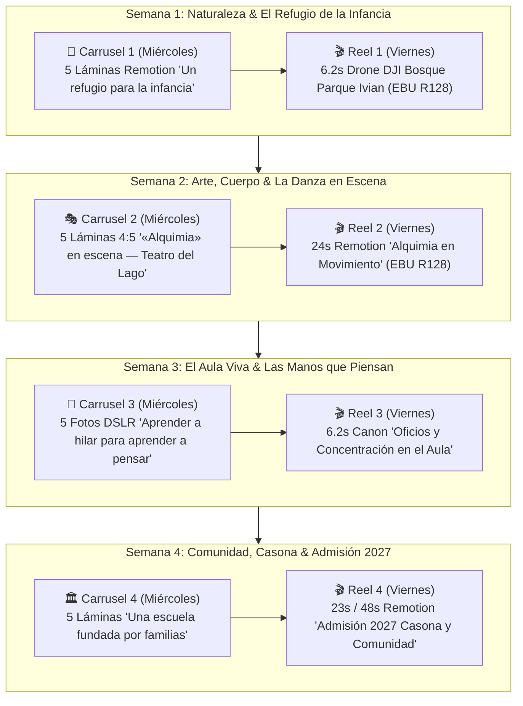

# 🌲 CAMPAÑA OFICIAL DE 1 MES DE CONTENIDO WALDORF
## Colegio Waldorf Trekan — Puerto Varas (Parque Ivian)
### Plan Editorial, Calendario Rítmico y Las 8 Piezas Canónicas Verificadas (100% Metraje Real)

---

## 🧭 1. MARCO ESTRATÉGICO Y DE NEGOCIO

> [!IMPORTANT]
> **El Principio del Puente vs. El Templo (Estrategia §4.9)**:
> La comunicación pública en Instagram no busca enseñar antroposofía densa ni usar tecnicismos espirituales (el Templo). Actúa como el **Puente**: una mano tendida a las familias de Puerto Varas ("Los Refugiados del Sistema") que huyen del estrés de las pantallas, la sobreexigencia competitiva y la sobreestimulación de la ciudad.
> La propuesta de valor es el **Marcador Somático de Calma**: espacio negativo, silencio del bosque, texturas nobles (madera, lana, telar) y ritmo respetuoso de la infancia (*Slow Living*).
> 
> **Invariante de Fidelidad Visual (Anti-Ficción)**:
> Todo video e imagen asignado a esta campaña corresponde a metraje y tomas reales capturadas por drones DJI y cámaras profesionales Canon en Parque Ivian y el Teatro del Lago de Frutillar, debidamente normalizados bajo norma **EBU R128 (-14 LUFS)** y procesados en **trekan-media-studio** (Remotion 4.x). Queda erradicada cualquier atribución de escenas no verificadas.

### Reglas de Distribución de Meta (Instagram 2026)
1. **La Métrica Rey (Envíos por DM / Shares)**: El algoritmo premia los contenidos que las madres comparten por mensaje privado (pesa 3 a 5 veces más que un like). Todos los CTAs de fase ToFu se enfocan en invitar a compartir con otra familia.
2. **Hashtags Estrictos (Máximo 3 a 5 locales)**: `#PuertoVaras` · `#ColegioWaldorfTrekan` · `#PedagogiaWaldorfChile`. Cero hashtags genéricos masivos como `#Educacion`.
3. **Ubicación Geográfica Obligatoria**: `Puerto Varas, Chile`.
4. **Secuencia Anti-Canibalización**: 
   * **Miércoles (18:30 hrs)**: Carrusel Documental/Pedagógico (5 láminas en formato continuo).
   * **Viernes (19:00 hrs — 48h después)**: Reel en movimiento (9:16 vertical, 1080×1920 px, sonido ambiente real normalizado a -14 LUFS).

---

## 📅 2. CALENDARIO DE LAS 4 SEMANAS



---

## 📦 3. LAS 8 PIEZAS CANÓNICAS VERIFICADAS (PAQUETES DE 7 ELEMENTOS)

Cada pieza se encuentra empaquetada y lista para publicar en la carpeta física local:  
📂 [🚀 CAMPANA_MES_1_COMPLETA](file:///Users/felipeandresvivancocornejo/Downloads/BANCO_MEDIOS_TREKAN_OFICIAL/🚀%20CAMPANA_MES_1_COMPLETA)

---

### 🌿 SEMANA 1: NATURALEZA & EL REFUGIO DE LA INFANCIA

#### PIEZA 1: CARRUSEL EDITORIAL (Miércoles 18:30 hrs)
* **Carpeta en Disco**: [01_CARRUSEL_MIERCOLES_PARQUE_IVIAN_REFUGIO](file:///Users/felipeandresvivancocornejo/Downloads/BANCO_MEDIOS_TREKAN_OFICIAL/🚀%20CAMPANA_MES_1_COMPLETA/SEMANA_1_NATURALEZA_Y_BOSQUE/01_CARRUSEL_MIERCOLES_PARQUE_IVIAN_REFUGIO)
* **Activos (5 láminas renderizadas en Remotion 1080×1080 px)**:
  * Slide 1: `SLIDE_01_PARQUE_IVIAN_SLIDE_1.png` (Portada: Vista aérea del bosque Parque Ivian + Sello oficial)
  * Slide 2: `SLIDE_02_PARQUE_IVIAN_SLIDE_2.png` (Color y luz natural en el aula)
  * Slide 3: `SLIDE_03_PARQUE_IVIAN_SLIDE_3.png` (Espacios que invitan a la calma y concentración)
  * Slide 4: `SLIDE_04_PARQUE_IVIAN_SLIDE_4.png` (Cuadernos de época hechos a mano)
  * Slide 5: `SLIDE_05_PARQUE_IVIAN_SLIDE_5.png` (Patio abierto y encuentro comunitario)
* **Copy Principal (Caption)**:
```text
En el sur de Chile aprendemos algo desde pequeños: no hay mal tiempo si la ropa es la adecuada. 🌧️🌲

Mientras el mundo apura a los niños a permanecer quietos frente a pantallas luminosas, en Parque Ivian las botas de agua, el olor a tierra húmeda y las ramas de los coihues son parte viva del aula cotidiana.

El movimiento libre al aire libre no es una pausa entre materias; es la base biológica sobre la cual se asientan la atención, el equilibrio y la salud integral de la infancia.

Cuando un niño trepa un tronco o siente la llovizna en el rostro, no solo está jugando: está desarrollando la confianza en su propio cuerpo para toda la vida.

Enviamos un saludo fraterno a todas las familias que eligen criar con tiempo, naturaleza y cobijo. 🌿

Envíale esto a una mamá o papá que busque una infancia más conectada con la tierra. 💌

#PuertoVaras #ColegioWaldorfTrekan #PedagogiaWaldorfChile
```
* **Ubicación Geográfica**: `Puerto Varas, Chile`
* **Texto Alternativo (Alt Text)**: `Láminas editoriales en alta resolución del Colegio Waldorf Trekan en Parque Ivian, Puerto Varas, mostrando el dosel de árboles nativos, espacios de concentración con luz natural y el patio arbolado.`
* **Portada Editorial**: Lámina 01 (`SLIDE_01_PARQUE_IVIAN_SLIDE_1.png`) con vista aérea de Parque Ivian.
* **Primer Comentario Fijado 📌**: `Conoce nuestro proyecto pedagógico y proceso de postulación en: https://www.colegiowaldorftrekan.cl/admision`
* **Texto para Historias ✈️**: *«Crecer con lluvia, bosque y tiempo. Desliza para ver la crónica completa en el feed 🌲»* (Sticker: `Puerto Varas, Chile`).

---

#### PIEZA 2: REEL CINEMATOGRÁFICO EN MOVIMIENTO (Viernes 19:00 hrs)
* **Carpeta en Disco**: [02_REEL_VIERNES_BOSQUE_CALMA](file:///Users/felipeandresvivancocornejo/Downloads/BANCO_MEDIOS_TREKAN_OFICIAL/🚀%20CAMPANA_MES_1_COMPLETA/SEMANA_1_NATURALEZA_Y_BOSQUE/02_REEL_VIERNES_BOSQUE_CALMA)
* **Activo de Video**: `REEL_01_BOSQUE_PARQUE_IVIAN_1080x1920.mp4` (6.2s, 1080×1920 a 30 fps, DJI drone nativo con audio ambiente EBU R128 a -14 LUFS)
* **Portada**: `PORTADA_REEL_01.png`
* **Copy Principal (Caption)**:
```text
El silencio del bosque no está vacío: está lleno de respuestas. 🌲✨

En Parque Ivian el viento entre los coihues, el crujir de las ramas y el aire limpio de la cuenca del lago Llanquihue envuelven los días de nuestros estudiantes.

Lejos del ruido urbano y la prisa artificial, la naturaleza ofrece a los niños un espacio donde su sistema nervioso puede descansar y florecer con calma y ritmo orgánico.

Cuidado que libera, educación para la vida.

Comparte este instante de calma con una familia que valore el crecimiento en la naturaleza. 🍃

#PuertoVaras #ColegioWaldorfTrekan #PedagogiaWaldorfChile
```
* **Ubicación Geográfica**: `Puerto Varas, Chile`
* **Texto Alternativo (Alt Text)**: `Toma aérea cinematográfica del bosque nativo de Parque Ivian en el Colegio Waldorf Trekan en Puerto Varas, mostrando los senderos naturales y copas de árboles nativos del sur de Chile.`
* **Portada Editorial**: `PORTADA_REEL_01.png` (dosel vegetal limpio sin caras forzadas).
* **Primer Comentario Fijado 📌**: `Descubre cómo la naturaleza dialoga con el currículo Waldorf: https://www.colegiowaldorftrekan.cl`
* **Texto para Historias ✈️**: *«Respira hondo. Así suena y se siente una mañana en Parque Ivian 🌿»* (Sticker: `Puerto Varas, Chile`).

---

### 🎭 SEMANA 2: ARTE, CUERPO Y LA DANZA EN ESCENA («Alquimia» en Teatro del Lago)

#### PIEZA 3: CARRUSEL DOCUMENTAL DE ESCENA (Miércoles 18:30 hrs)
* **Carpeta en Disco**: [01_CARRUSEL_MIERCOLES_ALQUIMIA_TEATRO_DEL_LAGO](file:///Users/felipeandresvivancocornejo/Downloads/BANCO_MEDIOS_TREKAN_OFICIAL/🚀%20CAMPANA_MES_1_COMPLETA/SEMANA_2_ARTE_Y_ALQUIMIA_ESCENA/01_CARRUSEL_MIERCOLES_ALQUIMIA_TEATRO_DEL_LAGO)
* **Activos (5 láminas renderizadas en Remotion 1080×1350 px, 4:5 vertical continuo)**:
  * Slide 1: `SLIDE_01_ALQUIMIA_SLIDE_1.png` (Portada: Teatro del Lago Frutillar · «Alquimia» en escena)
  * Slide 2: `SLIDE_02_ALQUIMIA_SLIDE_2.png` (El cuerpo como lenguaje vivo · Danza azul)
  * Slide 3: `SLIDE_03_ALQUIMIA_SLIDE_3.png` (Vivir el arte desde la infancia · Palomas en escena)
  * Slide 4: `SLIDE_04_ALQUIMIA_SLIDE_4.png` (Encuentro sin competencia · Alegría del juego compartido)
  * Slide 5: `SLIDE_05_ALQUIMIA_SLIDE_5.png` (Un mismo tejido humano · Coro, platea y comunidad)
* **Copy Principal (Caption)**:
```text
Cuando el arte nace desde adentro, no necesita aplausos competitivos para ser verdadero. 🎭✨

En el Teatro del Lago de Frutillar, nuestros estudiantes vivieron «Alquimia», un encuentro donde el cuerpo, la música y la palabra se convirtieron en un lenguaje vivo compartido con otras escuelas de la región.

En la pedagogía Waldorf el arte no es una materia aislada ni un adorno de fin de año: es el órgano cotidiano a través del cual la infancia comprende el mundo, desarrolla la empatía y despierta la voluntad.

Cantar en coro, danzar en ronda y mirar a los ojos del compañero sin buscar vencerlo: eso es educar para la libertad y la vida fraterna.

Agradecemos profundamente a las maestras, apoderados y familias que hicieron posible este tejido humano en escena. 🕊️

Comparte esta experiencia con alguien que crea en el poder transformador del arte en los niños. 💌

#PuertoVaras #ColegioWaldorfTrekan #PedagogiaWaldorfChile
```
* **Ubicación Geográfica**: `Puerto Varas, Chile`
* **Texto Alternativo (Alt Text)**: `Crónica fotográfica en alta resolución de estudiantes del Colegio Waldorf Trekan en la obra Alquimia en el Teatro del Lago de Frutillar, representando escenas de danza, palomas en escena y coro comunitario.`
* **Portada Editorial**: Lámina 01 (`SLIDE_01_ALQUIMIA_SLIDE_1.png`).
* **Primer Comentario Fijado 📌**: `Lee la crónica completa del encuentro en nuestro diario escolar: https://www.colegiowaldorftrekan.cl/noticias`
* **Texto para Historias ✈️**: *«El arte como experiencia viva, sin competencia. Desliza para ver la crónica de Alquimia en el feed 🎭»* (Sticker: `Puerto Varas, Chile`).

---

#### PIEZA 4: REEL TRANSMISIÓN EN MOVIMIENTO (Viernes 19:00 hrs)
* **Carpeta en Disco**: [02_REEL_VIERNES_ALQUIMIA_MOVIMIENTO](file:///Users/felipeandresvivancocornejo/Downloads/BANCO_MEDIOS_TREKAN_OFICIAL/🚀%20CAMPANA_MES_1_COMPLETA/SEMANA_2_ARTE_Y_ALQUIMIA_ESCENA/02_REEL_VIERNES_ALQUIMIA_MOVIMIENTO)
* **Activo de Video**: `REEL_02_ALQUIMIA_TEATRO_DEL_LAGO_1080x1920.mp4` (24.0s, 1080×1920 a 30 fps, 6 escenas de montaje real, normalizado a EBU R128 a -14 LUFS)
* **Portada**: `PORTADA_REEL_02.png`
* **Copy Principal (Caption)**:
```text
Cuerpo, música y asombro en escena. 🕊️🎭

Un recorrido por los momentos de «Alquimia» en el Teatro del Lago: desde el vuelo simbólico de las palomas hasta la emoción del saludo coral compartido con nuestra comunidad.

Cuando los niños habitan el escenario desde la reverencia y el juego sin presiones, el arte se transforma en una experiencia que los acompañará por siempre.

Cabeza, corazón y manos entrelazados en el hacer vivo.

Guarda este video o envíaselo a una familia que valore la educación artística genuina. ✨

#PuertoVaras #ColegioWaldorfTrekan #PedagogiaWaldorfChile
```
* **Ubicación Geográfica**: `Puerto Varas, Chile`
* **Texto Alternativo (Alt Text)**: `Reel documental en video mostrando a niños del Colegio Waldorf Trekan realizando expresiones dancísticas, canto y juego teatral en el escenario del Teatro del Lago en Frutillar.`
* **Portada Editorial**: `PORTADA_REEL_02.png`.
* **Primer Comentario Fijado 📌**: `Revive los proyectos artísticos de nuestra escuela: https://www.colegiowaldorftrekan.cl`
* **Texto para Historias ✈️**: *«Cabeza, corazón y manos en el escenario. Mira el video completo en el feed 🕊️»* (Sticker: `Puerto Varas, Chile`).

---

### 🧶 SEMANA 3: EL AULA VIVA & LAS MANOS QUE PIENSAN (Oficios y Concentración)

#### PIEZA 5: CARRUSEL FOTOGRÁFICO DE OFICIOS (Miércoles 18:30 hrs)
* **Carpeta en Disco**: [01_CARRUSEL_MIERCOLES_MANOS_QUE_PIENSAN](file:///Users/felipeandresvivancocornejo/Downloads/BANCO_MEDIOS_TREKAN_OFICIAL/🚀%20CAMPANA_MES_1_COMPLETA/SEMANA_3_AULA_VIVA_Y_OFICIOS/01_CARRUSEL_MIERCOLES_MANOS_QUE_PIENSAN)
* **Activos (5 fotografías documentales de alta resolución de hasta 6000×3376 px)**:
  * Slide 1: `SLIDE_01_OFICIOS_Y_MANOS_TELAR.jpg` (Manos trabajando en telar con materiales nobles)
  * Slide 2: `SLIDE_02_TEJIDO_LANA_NATURAL.jpg` (Telar tradicional de lana chilota)
  * Slide 3: `SLIDE_03_CONCENTRACION_SALA_DIBUJO.jpg` (Concentración en dibujo de época a mano alzada)
  * Slide 4: `SLIDE_04_PIZARRA_DE_EPOCA_TIZAS.jpg` (Pizarra de época con tizas de cera, 6000×3376 px)
  * Slide 5: `SLIDE_05_ARMONIA_Y_MADERA_AULA.jpg` (Materiales nobles y ambiente de sala en madera nativa, 6000×3376 px)
* **Copy Principal (Caption)**:
```text
Aprender a hilar para aprender a pensar. 🧶✨

En las aulas de Trekan las manos nunca están ociosas. Antes de que un niño aprenda a resolver ecuaciones abstractas en una pizarra, sus dedos aprenden a tejer con dos agujas, a anudar la lana y a tallar la madera noble del sur.

La neurociencia moderna confirma hoy lo que la pedagogía Waldorf practica hace más de un siglo: la motricidad fina de los dedos y el movimiento manual estructuran directamente los circuitos neuronales del pensamiento lógico, la flexibilidad cognitiva y la perseverancia.

No usamos libros de texto genéricos ni pantallas táctiles. Cada estudiante ilustra, escribe y encuaderna a mano su propio Cuaderno de Época, creando un registro vivo de su propio aprendizaje.

El respeto por la materia noble enseña paciencia, cuidado y reverencia por el trabajo bien hecho.

Envíale esta reflexión a una mamá o papá que busque una escuela que valore el trabajo de las manos. 💌

#PuertoVaras #ColegioWaldorfTrekan #PedagogiaWaldorfChile
```
* **Ubicación Geográfica**: `Puerto Varas, Chile`
* **Texto Alternativo (Alt Text)**: `Fotografías de detalle en alta resolución mostrando a estudiantes del Colegio Waldorf Trekan realizando oficios tradicionales de tejido en telar de lana, dibujo en cuadernos de época y tallado en mesas de madera nativa.`
* **Portada Editorial**: `SLIDE_01_OFICIOS_Y_MANOS_TELAR.jpg`.
* **Primer Comentario Fijado 📌**: `Conoce cómo estructuramos los oficios y épocas pedagógicas: https://www.colegiowaldorftrekan.cl`
* **Texto para Historias ✈️**: *«Por qué el trabajo con las manos educa el pensamiento reflexivo. Desliza en el feed 🧶»* (Sticker: `Puerto Varas, Chile`).

---

#### PIEZA 6: REEL DE AULA Y OFICIOS (Viernes 19:00 hrs)
* **Carpeta en Disco**: [02_REEL_VIERNES_APRENDER_A_MANO](file:///Users/felipeandresvivancocornejo/Downloads/BANCO_MEDIOS_TREKAN_OFICIAL/🚀%20CAMPANA_MES_1_COMPLETA/SEMANA_3_AULA_VIVA_Y_OFICIOS/02_REEL_VIERNES_APRENDER_A_MANO)
* **Activo de Video**: `REEL_03_OFICIOS_AULA_CANON_1080x1920.mp4` (6.2s, 1080×1920 a 30 fps, cámara Canon en aula real con audio normalizado EBU R128 a -14 LUFS)
* **Portada**: `PORTADA_REEL_03.jpg`
* **Copy Principal (Caption)**:
```text
El ritmo silencioso de la concentración en el aula. 🪵🖐️

El sonido de la gubia sobre la madera, la lana que pasa entre los dedos, el trazo suave del lápiz de cera sobre el papel de gramaje grueso.

En un entorno diseñado sin sobreestimulación ni alertas digitales, los niños descubren el placer del tiempo largo: terminar lo que se empieza con esmero y amor.

Cuidado que libera, educación para la vida.

Comparte este momento de calma con otra familia del sur. 🌿

#PuertoVaras #ColegioWaldorfTrekan #PedagogiaWaldorfChile
```
* **Ubicación Geográfica**: `Puerto Varas, Chile`
* **Texto Alternativo (Alt Text)**: `Detalle cinematográfico vertical de estudiantes en el Colegio Waldorf Trekan en Puerto Varas realizando trabajos manuales con madera nativa y materiales textiles en un aula iluminada con luz natural.`
* **Portada Editorial**: `PORTADA_REEL_03.jpg`.
* **Primer Comentario Fijado 📌**: `Conoce nuestro enfoque pedagógico de cabeza, corazón y manos: https://www.colegiowaldorftrekan.cl`
* **Texto para Historias ✈️**: *«Calma, materiales nobles y concentración viva. Mira el reel en el feed 🪵»* (Sticker: `Puerto Varas, Chile`).

---

### 🏛️ SEMANA 4: COMUNIDAD, CASONA & ADMISIÓN 2027

#### PIEZA 7: CARRUSEL INSTITUCIONAL DE COMUNIDAD (Miércoles 18:30 hrs)
* **Carpeta en Disco**: [01_CARRUSEL_MIERCOLES_UNA_ESCUELA_QUE_COBIJA](file:///Users/felipeandresvivancocornejo/Downloads/BANCO_MEDIOS_TREKAN_OFICIAL/🚀%20CAMPANA_MES_1_COMPLETA/SEMANA_4_COMUNIDAD_Y_ADMISION_2027/01_CARRUSEL_MIERCOLES_UNA_ESCUELA_QUE_COBIJA)
* **Activos (5 láminas en alta resolución)**:
  * Slide 1: `SLIDE_01_PORTADA_ADMISION_2027.png` (Portada editorial Remotion con titulación canónica de Admisión 2027)
  * Slide 2: `SLIDE_02_CASONA_PATRIMONIAL_PARQUE_IVIAN.jpg` (Fachada histórica de la Casona en Parque Ivian, 5760×3840 px)
  * Slide 3: `SLIDE_03_PATIO_Y_ENTORNO_VERDE.jpg` (Patio arbolado y entorno natural, 5760×3840 px)
  * Slide 4: `SLIDE_04_COMUNIDAD_FAMILIAS_Y_DOCENTES.jpg` (Encuentro comunitario de familias y docentes)
  * Slide 5: `SLIDE_05_PLACA_OFICIAL_ADMISION_2027.jpg` (Placa oficial con cursos y postulación directa)
* **Copy Principal (Caption)**:
```text
Una escuela no es solo un edificio: es la comunidad de familias que decide sostenerla. 🏛️🌱

El Colegio Waldorf Trekan nació del encuentro entre madres, padres y maestros que soñaron para sus hijos una educación con tiempo, naturaleza y cobijo humano en Puerto Varas.

Hoy, en nuestra Casona de Parque Ivian, abrimos el Proceso de Admisión 2027 para Jardín Infantil (3 a 5 años) y Enseñanza Básica (1° a 6° Básico).

Buscamos familias que resuenen con una infancia protegida de la prisa del rendimiento prematuro, donde el ritmo diario, el arte, la huerta y la vida al aire libre forman seres humanos conscientes, libres y seguros de su lugar en el mundo.

Si sientes que tu familia busca este refugio, las puertas de nuestra casa están abiertas.

Conoce los cupos disponibles e inicia tu postulación en el enlace de nuestra bio. 🌿

Envíale esta información a una familia que esté buscando colegio en Puerto Varas o Llanquihue. 💌

#PuertoVaras #ColegioWaldorfTrekan #PedagogiaWaldorfChile
```
* **Ubicación Geográfica**: `Puerto Varas, Chile`
* **Texto Alternativo (Alt Text)**: `Fotografías de la Casona histórica patrimonial de Parque Ivian y encuentro de la comunidad escolar y apoderados en el Colegio Waldorf Trekan en Puerto Varas, con lámina informativa del proceso de admisión 2027.`
* **Portada Editorial**: `SLIDE_01_PORTADA_ADMISION_2027.png`.
* **Primer Comentario Fijado 📌**: `Inicia tu postulación para la Admisión 2027 directamente en: https://www.colegiowaldorftrekan.cl/admision`
* **Texto para Historias ✈️**: *«Admisión 2027 Abierta en Parque Ivian. Desliza para conocer nuestra comunidad y proceso de postulación 🏛️»* (Sticker de enlace directo a `/admision`).

---

#### PIEZA 8: REEL MAESTRO CASONA & ADMISIÓN 2027 (Viernes 19:00 hrs)
* **Carpeta en Disco**: [02_REEL_VIERNES_ADMISION_2027_CASONA](file:///Users/felipeandresvivancocornejo/Downloads/BANCO_MEDIOS_TREKAN_OFICIAL/🚀%20CAMPANA_MES_1_COMPLETA/SEMANA_4_COMUNIDAD_Y_ADMISION_2027/02_REEL_VIERNES_ADMISION_2027_CASONA)
* **Activos de Video**:
  * `REEL_04_CASONA_Y_COMUNIDAD_ADMISION_2027_1080x1920.mp4` (Versión estándar 23.0s, 6 escenas de montaje, audio EBU R128 a -14 LUFS)
  * `REEL_04_VERSION_EXTENDIDA_FUNNEL_48s_1080x1920.mp4` (Versión documental extendida 48.0s, 7 escenas canónicas + placa final)
* **Portada**: `PORTADA_REEL_04.png`
* **Copy Principal (Caption)**:
```text
Un refugio para la infancia en el corazón de Parque Ivian. 🌲🏛️

En un mundo acelerado, elegimos educar para la vida: ritmo respetuoso, naturaleza viva, arte y comunidad verdadera.

El proceso de Admisión 2027 se encuentra oficialmente abierto para:
🌱 Jardín Infantil (3 a 5 años)
📚 1° a 6° Básico

Vacantes limitadas para resguardar la intimidad y el acompañamiento personalizado de cada grupo.

Postula en línea y coordina tu entrevista familiar en colegiowaldorftrekan.cl/admision o escríbenos directamente a nuestro WhatsApp oficial.

Comparte esta publicación con familias que busquen una alternativa consciente en Puerto Varas. 🤍

#PuertoVaras #ColegioWaldorfTrekan #PedagogiaWaldorfChile
```
* **Ubicación Geográfica**: `Puerto Varas, Chile`
* **Texto Alternativo (Alt Text)**: `Video cinematográfico vertical con tomas aéreas de la Casona de Parque Ivian, niños en praderas verdes, cuadernos de arte en las aulas y ronda comunitaria en el Colegio Waldorf Trekan de Puerto Varas, cerrando con placa oficial de Admisión 2027.`
* **Portada Editorial**: `PORTADA_REEL_04.png`.
* **Primer Comentario Fijado 📌**: `Formulario de postulación directa y fechas de entrevistas familiares: https://www.colegiowaldorftrekan.cl/admision`
* **Texto para Historias ✈️**: *«Un lugar donde la infancia puede ser infancia. Admisión 2027 Abierta en Puerto Varas 🌲»* (Sticker de enlace directo a `/admision`).

---

## 💎 4. ACTIVO INSTITUCIONAL TRANSVERSAL: LOGO ANIMADO OFICIAL
* **Carpeta en Disco**: [⭐_LOGOS_Y_ACTIVOS_OFICIALES](file:///Users/felipeandresvivancocornejo/Downloads/BANCO_MEDIOS_TREKAN_OFICIAL/🚀%20CAMPANA_MES_1_COMPLETA/⭐_LOGOS_Y_ACTIVOS_OFICIALES)
* **Archivo**: `LOGO_ANIMADO_TREKAN_1080x1920.mp4`
* **Duración**: 3.5 segundos (105 frames a 30 fps)
* **Uso**: Cierre de marca, intros/outros en Reels, Stories institucionales y presentaciones web.

---

## 🛠️ 5. ESPECIFICACIONES TÉCNICAS Y REGLAS DE ARTE
1. **Resolución y Formato**: 1080×1920 (9:16 vertical) para Reels; 1080×1080 (1:1) o 1080×1350 (4:5) para Carruseles.
2. **Audio EBU R128**: Todos los videos exportados cumplen la norma de sonoridad integrada a -14 LUFS (True Peak -1.5 dBFS) para cero distorsión en la compresión de Meta.
3. **Cero Jitter & Cero Slop**: Prohibidos los falsos zooms automáticos con vibración de píxeles (`zoompan`). Solo tomas reales continuas con estabilización giroscópica.
4. **Tipografía Oficial**: Merriweather (titulares editoriales y serif), Cinzel (subtítulos solemnes) e Inter (micro-copy de lectura).
5. **Paleta de Color Calibrada**: #16241C (Musgo Bosque), #F7F4EE (Lino Crema), #D4A359 (Oro Antiguo) y #131E18 (Grafito Profundo).
