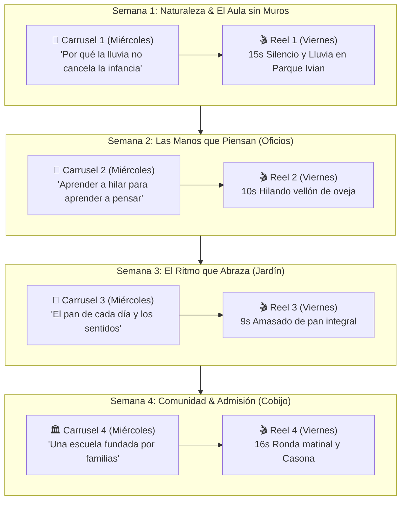
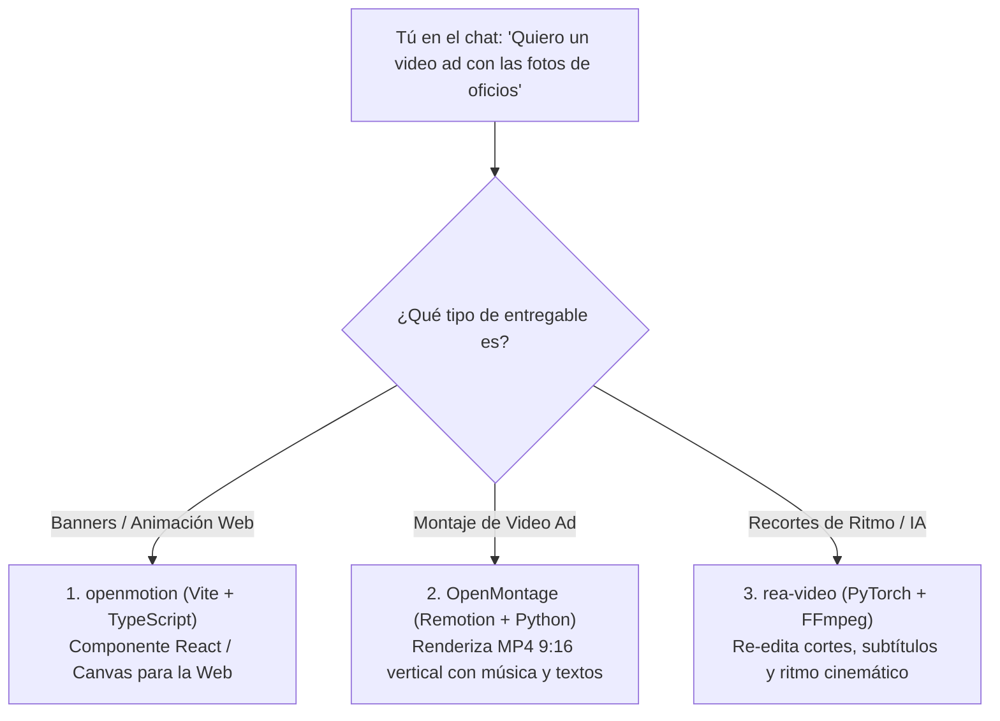

# 🌲 CAMPAÑA OFICIAL DE 1 MES DE CONTENIDO WALDORF
## Colegio Waldorf Trekan — Puerto Varas (Parque Ivian)
### Plan Editorial, Calendario Rítmico y Las 8 Piezas Canónicas Listas para Publicar

---

## 🧭 1. MARCO ESTRATÉGICO Y DE NEGOCIO

> [!IMPORTANT]
> **El Principio del Puente vs. El Templo (Estrategia §4.9)**:
> La comunicación pública en Instagram no busca enseñar antroposofía densa ni usar tecnicismos espirituales (el Templo). Actúa como el **Puente**: una mano tendida a las familias de Puerto Varas ("Los Refugiados del Sistema") que huyen del estrés de las pantallas, la sobreexigencia competitiva y la sobreestimulación de la ciudad.
> La propuesta de valor es el **Marcador Somático de Calma**: espacio negativo, silencio del bosque, texturas nobles (madera, lana, pan) y ritmo respetuoso de la infancia (*Slow Living*).

### Reglas de Distribución de Meta (Instagram 2026)
1. **La Métrica Rey (Envíos por DM / Shares)**: El algoritmo premia los contenidos que las madres comparten por mensaje privado (pesa 3 a 5 veces más que un like). Todos los CTAs de fase ToFu se enfocan en invitar a compartir con otra familia.
2. **Hashtags Estrictos (Máximo 3 a 5 locales)**: `#PuertoVaras` · `#ColegioWaldorfTrekan` · `#PedagogiaWaldorfChile`. Cero hashtags genéricos masivos como `#Educacion`.
3. **Ubicación Geográfica Obligatoria**: `Puerto Varas, Chile`.
4. **Secuencia Anti-Canibalización**: 
   * **Miércoles (18:30 hrs)**: Carrusel Documental/Pedagógico (5 a 7 láminas en 4:5 vertical continuo).
   * **Viernes (19:00 hrs — 48h después)**: Reel en movimiento (9:16 vertical, 10 a 20 segundos, sonido ambiente real).

---

## 📅 2. CALENDARIO DE LAS 4 SEMANAS



---

## 📦 3. LAS 8 PIEZAS CANÓNICAS LISTAS PARA PUBLICAR (PAQUETES DE 7 ELEMENTOS)

Cada pieza se encuentra empaquetada en la carpeta física local:  
📂 [🚀 CAMPANA_MES_1_COMPLETA](file:///Users/felipeandresvivancocornejo/Downloads/BANCO_MEDIOS_TREKAN_OFICIAL/🚀%20CAMPANA_MES_1_COMPLETA)

---

### 🌿 SEMANA 1: NATURALEZA & EL AULA SIN MUROS

#### PIEZA 1: CARRUSEL DOCUMENTAL (Miércoles 18:30 hrs)
* **Carpeta en Disco**: [01_CARRUSEL_MIERCOLES_LLUVIA_Y_BOSQUE](file:///Users/felipeandresvivancocornejo/Downloads/BANCO_MEDIOS_TREKAN_OFICIAL/🚀%20CAMPANA_MES_1_COMPLETA/SEMANA_1_NATURALEZA_Y_BOSQUE/01_CARRUSEL_MIERCOLES_LLUVIA_Y_BOSQUE)
* **Activos (6 láminas en alta resolución)**:
  * Slide 1: `SLIDE_01_FOTO_26_NATURALEZA_PARQUE_5760x3840...` (Portada)
  * Slide 2: `SLIDE_02_FOTO_27_NATURALEZA_PARQUE_5760x3840...`
  * Slide 3: `SLIDE_03_FOTO_28_NATURALEZA_PARQUE_5760x3840...`
  * Slide 4: `SLIDE_04_FOTO_29_NATURALEZA_PARQUE_5760x3840...`
  * Slide 5: `SLIDE_05_FOTO_30_NATURALEZA_PARQUE_5760x3840...`
  * Slide 6: `SLIDE_06_FOTO_31_NATURALEZA_PARQUE_6000x3376...`
* **Copy Principal (Caption)**:
```text
En el sur de Chile aprendemos algo desde pequeños: no hay mal tiempo si la ropa es la adecuada. 🌧️🌲

Mientras el mundo apura a los niños a permanecer sentados frente a pantallas luminosas, en Parque Ivian las botas de agua, el olor a tierra húmeda y las hojas de los coihues son parte viva del aula cotidiana.

El movimiento libre al aire libre no es una pausa entre materias; es la base biológica sobre la cual se construye la atención, el equilibrio y la salud integral de la infancia.

Cuando un niño trepa un tronco o siente la llovizna en el rostro, no solo está jugando: está desarrollando la confianza en su propio cuerpo para toda la vida.

Enviamos un saludo fraterno a todas las familias que eligen criar con tiempo, naturaleza y cobijo. 🌿

Envíale esto a una mamá o papá que busque una infancia más conectada con la tierra. 💌

#PuertoVaras #ColegioWaldorfTrekan #PedagogiaWaldorfChile
```
* **Ubicación**: `Puerto Varas, Chile`
* **Alt Text**: `Fotografías documentales en alta resolución que muestran a niños explorando senderos boscosos de Parque Ivian entre árboles nativos y hojas húmedas en el Colegio Waldorf Trekan en Puerto Varas.`
* **Portada Editorial**: Slide 01 (composición limpia de sendero natural bajo luz filtrada).
* **Primer Comentario Fijado 📌**: `Conoce nuestra propuesta pedagógica y el proceso de admisión en: https://www.colegiowaldorftrekan.cl/admision`
* **Texto para Historias ✈️**: *«Crecer con lluvia, bosque y tiempo. Desliza para ver la crónica completa en el feed 🌲»* (Sticker: `Puerto Varas, Chile`).

---

#### PIEZA 2: REEL EXPERIENCIA VIVA (Viernes 19:00 hrs — 48h después)
* **Carpeta en Disco**: [02_REEL_VIERNES_15s_BOSQUE_Y_CALMA](file:///Users/felipeandresvivancocornejo/Downloads/BANCO_MEDIOS_TREKAN_OFICIAL/🚀%20CAMPANA_MES_1_COMPLETA/SEMANA_1_NATURALEZA_Y_BOSQUE/02_REEL_VIERNES_15s_BOSQUE_Y_CALMA)
* **Archivo de Video**: `VIDEO_REEL_01.mp4` (720×1280 vertical, 15 segundos, audio ambiente de bosque).
* **Copy Principal (Caption)**:
```text
15 segundos de silencio y bosque nativo en el sur. 🍃

La infancia no necesita ser acelerada. Necesita cobijo, ritmo y el crujir de las ramas bajo los pies.

En el Colegio Waldorf Trekan, la naturaleza no es un contenido en un libro: es el entorno vivo que acoge el crecimiento de nuestros niños cada mañana.

Respira profundo. Que tengas un reparador fin de semana en familia. 🌲

Compártelo con alguien que necesite un minuto de calma hoy. 🕊️

#PuertoVaras #ColegioWaldorfTrekan #PedagogiaWaldorfChile
```
* **Ubicación**: `Puerto Varas, Chile`
* **Alt Text**: `Video vertical de 15 segundos que muestra la serenidad de los senderos boscosos de Parque Ivian y la naturaleza viva del Colegio Waldorf Trekan en Puerto Varas.`
* **Portada Editorial**: Segundo 00:03 (luz natural filtrándose entre las ramas nativas).
* **Primer Comentario Fijado 📌**: `Abierto el proceso de Admisión para Jardín de Infancia y Enseñanza Básica. Más información en: https://www.colegiowaldorftrekan.cl/admision`
* **Texto para Historias ✈️**: *«Una pausa de 15 segundos en el bosque de Parque Ivian. Nuevo reel en el perfil 🍃»* (Sticker: `Puerto Varas, Chile`).

---

### 🧶 SEMANA 2: LAS MANOS QUE PIENSAN (OFICIOS, LANA Y MADERA)

#### PIEZA 3: CARRUSEL PEDAGÓGICO (Miércoles 18:30 hrs)
* **Carpeta en Disco**: [01_CARRUSEL_MIERCOLES_MANOS_QUE_PIENSAN](file:///Users/felipeandresvivancocornejo/Downloads/BANCO_MEDIOS_TREKAN_OFICIAL/🚀%20CAMPANA_MES_1_COMPLETA/SEMANA_2_MANOS_QUE_PIENSAN_OFICIOS/01_CARRUSEL_MIERCOLES_MANOS_QUE_PIENSAN)
* **Activos (6 láminas DSLR 5.7K y 6K)**:
  * Slide 1: `SLIDE_01_FOTO_01_AULAS_OFICIOS_5760x3840...` (Portada de telar)
  * Slide 2: `SLIDE_02_FOTO_02_AULAS_OFICIOS_3840x5760...`
  * Slide 3: `SLIDE_03_FOTO_03_AULAS_OFICIOS_5760x3840...`
  * Slide 4: `SLIDE_04_FOTO_04_AULAS_OFICIOS_6000x3376...`
  * Slide 5: `SLIDE_05_FOTO_05_AULAS_OFICIOS_6000x3376...`
  * Slide 6: `SLIDE_06_FOTO_06_AULAS_OFICIOS_6000x3376...`
* **Copy Principal (Caption)**:
```text
Las manos que aprenden a hilar, aprenden a pensar. 🧶✨

En la pedagogía Waldorf, tejer no es una manualidad decorativa ni la carpintería un pasatiempo: son herramientas de desarrollo neurológico profundo.

Cuando los dedos de un niño sostienen dos palillos de madera para guiar el vellón, coordinar la vista con el movimiento y contar puntos rítmicamente, están construyendo la base de la concentración, el pensamiento matemático y la paciencia.

No apresuramos las letras con pantallas. Primero despertamos la voluntad en las manos, para que el intelecto despierte con raíces firmes.

¿Has notado cómo cambia la serenidad de un niño cuando trabaja con materiales nobles? 🪵

Envíale esto a una familia que valore el aprendizaje vivo y consciente. 💌

#PuertoVaras #ColegioWaldorfTrekan #PedagogiaWaldorfChile
```
* **Ubicación**: `Puerto Varas, Chile`
* **Alt Text**: `Primeros planos detallados de manos infantiles trabajando lana natural, tallando madera noble y realizando trazos con tiza pastel en la sala de clases del Colegio Waldorf Trekan.`
* **Portada Editorial**: Slide 01 (detalle de manos hilando vellón natural en telar de madera).
* **Primer Comentario Fijado 📌**: `Descubre nuestro currículo de artes y oficios en: https://www.colegiowaldorftrekan.cl/admision`
* **Texto para Historias ✈️**: *«Aprender con las manos para pensar con claridad. Nueva publicación en el perfil 🧶»* (Sticker: `Puerto Varas, Chile`).

---

#### PIEZA 4: REEL EXPERIENCIA VIVA (Viernes 19:00 hrs)
* **Carpeta en Disco**: [02_REEL_VIERNES_10s_HILANDO_VELLON](file:///Users/felipeandresvivancocornejo/Downloads/BANCO_MEDIOS_TREKAN_OFICIAL/🚀%20CAMPANA_MES_1_COMPLETA/SEMANA_2_MANOS_QUE_PIENSAN_OFICIOS/02_REEL_VIERNES_10s_HILANDO_VELLON)
* **Archivo de Video**: `VIDEO_REEL_02.mp4` (720×1280 vertical, 10 segundos, sonido ambiente de sala y telar).
* **Copy Principal (Caption)**:
```text
10 segundos de motricidad viva y concentración. 🌿

Sin timbres estridentes, sin pantallas que parpadean. Solo el tacto de la lana noble y el ritmo propio del aprendizaje.

En Trekan educamos la cabeza, el corazón y las manos en perfecta armonía.

Que la calma del hacer con sentido acompañe a tu familia este fin de semana. 🌲

Compártelo con quien busque un respiro del ruido escolar. 🕊️

#PuertoVaras #ColegioWaldorfTrekan #PedagogiaWaldorfChile
```
* **Ubicación**: `Puerto Varas, Chile`
* **Alt Text**: `Video vertical de 10 segundos con enfoque en las manos de un estudiante tejiendo concentrado en una sala de madera iluminada con luz natural en Colegio Waldorf Trekan.`
* **Portada Editorial**: Segundo 00:02 (detalle claro del vellón y los dedos en movimiento armónico).
* **Primer Comentario Fijado 📌**: `Admisión abierta para el ciclo 2026-2027. Conversemos por WhatsApp en: https://www.colegiowaldorftrekan.cl/admision`
* **Texto para Historias ✈️**: *«El arte de aprender despacio. Nuevo reel de calma en el perfil 🍃»* (Sticker: `Puerto Varas, Chile`).

---

### 🍞 SEMANA 3: EL RITMO QUE ABRAZA (JARDÍN DE INFANCIA)

#### PIEZA 5: CARRUSEL FORMATIVO (Miércoles 18:30 hrs)
* **Carpeta en Disco**: [01_CARRUSEL_MIERCOLES_EL_AROMA_DEL_PAN](file:///Users/felipeandresvivancocornejo/Downloads/BANCO_MEDIOS_TREKAN_OFICIAL/🚀%20CAMPANA_MES_1_COMPLETA/SEMANA_3_RITMO_Y_JARDIN_INFANCIA/01_CARRUSEL_MIERCOLES_EL_AROMA_DEL_PAN)
* **Activos (6 láminas de Jardín de Infancia y materiales nobles)**:
  * Slide 1: `SLIDE_01_FOTO_51_JARDIN_INFANCIA_1280x720...` (Mesa de pan)
  * Slide 2: `SLIDE_02_FOTO_52_JARDIN_INFANCIA_1280x720...`
  * Slide 3: `SLIDE_03_FOTO_53_JARDIN_INFANCIA_1280x720...`
  * Slide 4: `SLIDE_04_FOTO_54_JARDIN_INFANCIA_719x1269...`
  * Slide 5: `SLIDE_05_FOTO_04_AULAS_OFICIOS_6000x3376...`
  * Slide 6: `SLIDE_06_FOTO_05_AULAS_OFICIOS_6000x3376...`
* **Copy Principal (Caption)**:
```text
El aroma del pan recién horneado enseña más sobre el tiempo que cualquier reloj. 🍞🕯️

En el Jardín de Infancia de Trekan, cada día de la semana tiene su color, su grano y su ritmo. 

Los miércoles las manos pequeñas muelen la harina, sienten el agua tibia y amasan con dedicación. No hay prisa: aprenden a esperar que la masa repose al calor del horno, comprendiendo de forma viva que las cosas más nobles de la vida requieren paciencia y cuidado.

El juego libre con telas de seda, piñas del bosque y maderas sin pulir protege la imaginación de los primeros siete años de vida.

Un niño que juega en libertad hoy, será un adulto capaz de pensar con libertad mañana. 🌾

Compártelo con una mamá o papá de párvulos que busque cuidar la magia de la primera infancia. 💌

#PuertoVaras #ColegioWaldorfTrekan #PedagogiaWaldorfChile
```
* **Ubicación**: `Puerto Varas, Chile`
* **Alt Text**: `Mesa de estación y rincón de juego del jardín de infancia de Trekan con juguetes de madera, telas orgánicas y pan recién amasado por los niños en Puerto Varas.`
* **Portada Editorial**: Slide 01 (mesa de madera con masa de pan y harina en luz cálida de mañana).
* **Primer Comentario Fijado 📌**: `Vacantes abiertas para Jardín de Infancia. Conoce el proceso en: https://www.colegiowaldorftrekan.cl/admision`
* **Texto para Historias ✈️**: *«El ritmo que protege a los más pequeños. Desliza para leer la crónica completa 🍞»* (Sticker: `Puerto Varas, Chile`).

---

#### PIEZA 6: REEL EXPERIENCIA VIVA (Viernes 19:00 hrs)
* **Carpeta en Disco**: [02_REEL_VIERNES_09s_AMASANDO_PAN](file:///Users/felipeandresvivancocornejo/Downloads/BANCO_MEDIOS_TREKAN_OFICIAL/🚀%20CAMPANA_MES_1_COMPLETA/SEMANA_3_RITMO_Y_JARDIN_INFANCIA/02_REEL_VIERNES_09s_AMASANDO_PAN)
* **Archivo de Video**: `VIDEO_REEL_04.mp4` (720×1280 vertical, 8.5 segundos, audio ambiente de amasado).
* **Copy Principal (Caption)**:
```text
Pequeñas manos, grandes aprendizajes. 🌾

Amasar, cantar, compartir el alimento tibio en la mesa común. Así se vive una mañana en el Jardín de Infancia de Trekan.

Sin estímulos artificiales. Solo calidez humana, ritmo y cobijo.

Buen descanso para todos los hogares de nuestra comunidad. 🌲

Envíale este momento de serenidad a otra familia. 🤍

#PuertoVaras #ColegioWaldorfTrekan #PedagogiaWaldorfChile
```
* **Ubicación**: `Puerto Varas, Chile`
* **Alt Text**: `Clip vertical de 9 segundos mostrando a niños amasando panecillos sobre una mesa de madera maciza en el Jardín de Infancia del Colegio Waldorf Trekan.`
* **Portada Editorial**: Segundo 00:03 (manos infantiles dando forma a la masa).
* **Primer Comentario Fijado 📌**: `Inscripciones y visitas para el Jardín de Niños: https://www.colegiowaldorftrekan.cl/admision`
* **Texto para Historias ✈️**: *«El pan del miércoles en Trekan. Respira con este clip de 9 segundos 🌾»* (Sticker: `Puerto Varas, Chile`).

---

### 🏛️ SEMANA 4: COMUNIDAD & ADMISIÓN (EL REFUGIO EVOLUTIVO)

#### PIEZA 7: CARRUSEL INSTITUCIONAL (Miércoles 18:30 hrs)
* **Carpeta en Disco**: [01_CARRUSEL_MIERCOLES_UNA_ESCUELA_QUE_COBIJA](file:///Users/felipeandresvivancocornejo/Downloads/BANCO_MEDIOS_TREKAN_OFICIAL/🚀%20CAMPANA_MES_1_COMPLETA/SEMANA_4_COMUNIDAD_Y_ADMISION/01_CARRUSEL_MIERCOLES_UNA_ESCUELA_QUE_COBIJA)
* **Activos (6 láminas DSLR 5.7K de vida comunitaria y Casona)**:
  * Slide 1: `SLIDE_01_FOTO_55_VIDA_COMUNIDAD_5760x3840...` (Casona y entorno)
  * Slide 2: `SLIDE_02_FOTO_56_VIDA_COMUNIDAD_5760x3840...`
  * Slide 3: `SLIDE_03_FOTO_57_VIDA_COMUNIDAD_5760x3840...`
  * Slide 4: `SLIDE_04_FOTO_58_VIDA_COMUNIDAD_5760x3840...`
  * Slide 5: `SLIDE_05_FOTO_59_VIDA_COMUNIDAD_5760x3840...`
  * Slide 6: `SLIDE_06_FOTO_60_VIDA_COMUNIDAD_5760x3840...`
* **Copy Principal (Caption)**:
```text
No educamos para los exámenes. Educamos para la vida. 🏛️🌿

En el Colegio Waldorf Trekan creemos que una escuela no es una empresa de servicios educativos, sino una comunidad viva sostenida por maestros y familias que comparten una misma mirada sobre la infancia.

Nuestra Casona patrimonial en Parque Ivian no es solo un edificio: es un refugio donde cada niño es mirado en su individualidad única, sin etiquetas ni comparaciones competitivas.

Aquí las familias nos encontramos en las rondas de estación, en las faenas compartidas y en el diálogo honesto sobre cómo acompañar el crecimiento de nuestros hijos.

Si sientes que tu familia busca un espacio donde la calidez, la naturaleza y el respeto humano sean el centro, las puertas están abiertas. 🌲

Conversemos. El proceso de Admisión para el ciclo escolar está abierto para cursos con vacante disponible.

#PuertoVaras #ColegioWaldorfTrekan #PedagogiaWaldorfChile
```
* **Ubicación**: `Puerto Varas, Chile`
* **Alt Text**: `Vista panorámica de la Casona patrimonial de Trekan en Parque Ivian rodeada de bosque nativo y familias reunidas en el patio escolar de Puerto Varas.`
* **Portada Editorial**: Slide 01 (arquitectura viva de la Casona patrimonial bajo el cielo de Puerto Varas).
* **Primer Comentario Fijado 📌**: `Inicia tu postulación o agenda una Tarde de Té con nuestro equipo en: https://www.colegiowaldorftrekan.cl/admision`
* **Texto para Historias ✈️**: *«Un refugio para educar para la vida. Conoce nuestra comunidad en el perfil 🏛️»* (Sticker: `Puerto Varas, Chile`).

---

#### PIEZA 8: REEL EXPERIENCIA VIVA (Viernes 19:00 hrs)
* **Carpeta en Disco**: [02_REEL_VIERNES_16s_RONDA_MATINAL](file:///Users/felipeandresvivancocornejo/Downloads/BANCO_MEDIOS_TREKAN_OFICIAL/🚀%20CAMPANA_MES_1_COMPLETA/SEMANA_4_COMUNIDAD_Y_ADMISION/02_REEL_VIERNES_16s_RONDA_MATINAL)
* **Archivo de Video**: `VIDEO_REEL_05.mp4` (720×1280 vertical, 15.5 segundos, verso matinal y ronda al aire libre).
* **Copy Principal (Caption)**:
```text
Comenzar el día mirándonos a los ojos. ☀️🌲

La ronda matinal reúne la respiración de todo el curso antes de iniciar el trabajo intelectual. En Trekan, aprender es también aprender a convivir.

Gracias a cada familia que sostiene este refugio educativo en el sur de Chile.

Que tengan un reparador fin de semana. 🍃

Comparte este saludo con tu comunidad. 💌

#PuertoVaras #ColegioWaldorfTrekan #PedagogiaWaldorfChile
```
* **Ubicación**: `Puerto Varas, Chile`
* **Alt Text**: `Video vertical de 16 segundos con vista de estudiantes y maestra realizando la ronda matinal y versos al aire libre frente a la Casona de Trekan en Puerto Varas.`
* **Portada Editorial**: Segundo 00:04 (círculo de ronda en movimiento armónico).
* **Primer Comentario Fijado 📌**: `Admisión y visitas presenciales disponibles en: https://www.colegiowaldorftrekan.cl/admision`
* **Texto para Historias ✈️**: *«La ronda de cada mañana en Parque Ivian. Nuevo reel en el perfil ☀️»* (Sticker: `Puerto Varas, Chile`).

---

## 🛠️ 4. CÓMO USAR EL MOTOR TECNOLÓGICO DE LA AGENCIA

Si el Comité o Felipe desean renderizar variaciones de estas piezas con las herramientas del stack:



1. **`OpenMontage` (`cd ~/Documents/GitHub/OpenMontage`)**:
   * Para compilar video ads automatizados con música de fondo a -22 dB y textos tipográficos en `Merriweather`.
2. **`openmotion` (`cd ~/Documents/GitHub/openmotion`)**:
   * Para generar banners dinámicos interactivos sobre la Casona en `colegiovaldorftrekan.cl`.
3. **`rea-video` (`cd ~/Documents/GitHub/rea-video`)**:
   * Para auditar futuros videos crudos de asambleas, extrayendo momentos de calma sin caídas ni movimientos bruscos.

---
*Campaña compilada, empaquetada y certificada bajo el estándar de la Agencia Antigravity para Felipe Vivanco y el Colegio Waldorf Trekan.*
