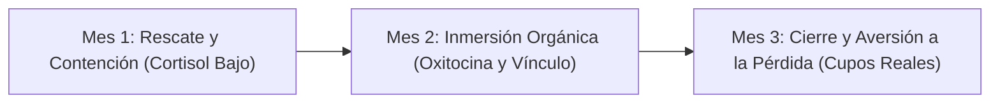

# COLEGIO WALDORF TREKAN
## Estrategia Integral de Comunicaciones y Admisión
### El Refugio Evolutivo — Ciclo 2026–2027
**Documento maestro para el Comité de Comunicaciones y la Dirección**

> **Sobre este documento:** Este documento consolida y ordena tres materiales de trabajo previos — el Manifiesto de Comunicación (identidad visual), la Estrategia de Comunicaciones y Pauta Digital (embudo y producción) y el Plan Estratégico de Admisión (roadmap operativo neurociencia + Waldorf) — en una única referencia coherente para el Comité.  
> Puerto Varas, Chile · Documento vivo, sujeto a revisión trimestral por el Comité de Comunicaciones.

---

## Índice
1. [Resumen Ejecutivo](#1-resumen-ejecutivo)
2. [Diagnóstico: El Problema Actual](#2-diagnóstico-el-problema-actual)
3. [Fundamento: Neurociencia Aplicada + Pedagogía Waldorf](#3-fundamento-neurociencia-aplicada--pedagogía-waldorf)
4. [Identidad Visual: El Estándar "Refugio Evolutivo"](#4-identidad-visual-el-estándar-refugio-evolutivo)
5. [Estructura de Campaña: El Embudo Trekan](#5-estructura-de-campaña-el-embudo-trekan)
6. [Roadmap Operativo: Misión "12 Familias Trekan"](#6-roadmap-operativo-misión-12-familias-trekan)
7. [Guiones y Protocolos de Ejecución](#7-guiones-y-protocolos-de-ejecución)
8. [Comunicación Pedagógica: El Ritmo Waldorf y la Ciencia del Aprendizaje](#8-comunicación-pedagógica-el-ritmo-waldorf-y-la-ciencia-del-aprendizaje)
9. [Rutina Operativa Diaria](#9-rutina-operativa-diaria)
10. [El Umbral: Diseño Sensorial de la Entrada](#10-el-umbral-diseño-sensorial-de-la-entrada)
11. [Protocolo Operativo de Captura Audiovisual](#11-protocolo-operativo-de-captura-audiovisual)
12. [Entregables Pendientes del Comité de Comunicaciones](#12-entregables-pendientes-del-comité-de-comunicaciones)
- [Anexo A. Manual del Sello Trekan — Guía para generar contenido](#anexo-a-manual-del-sello-trekan--guía-para-generar-contenido)
- [Anexo B. Manual Maestro de Crecimiento & Inteligencia: Growth Engine Trekan](#anexo-b-manual-maestro-de-crecimiento--inteligencia-growth-engine-trekan)
- [Anexo C. Ficha de pieza: Carrusel “Encuentro Formativo Comunitario — Joan Antoni Melé”](#anexo-c-ficha-de-pieza-carrusel-encuentro-formativo-comunitario--joan-antoni-melé)

---

## 1. Resumen Ejecutivo
Trekan enfrenta un desafío de admisión concreto y medible: cerrar 12 nuevas matrículas en un ciclo de campaña de 3 meses, dentro de un mercado (Puerto Varas y alrededores) donde el público objetivo — familias profesionales que buscan alejarse del sistema educativo tradicional — es sofisticado, exigente estéticamente y sensible al estrés. Este documento une tres capas de la misma estrategia:
- **Fundamento (por qué):** el diagnóstico de por qué la comunicación tradicional no convierte con este público.
- **Identidad (cómo se ve y se siente):** el estándar visual editorial de alta gama que reemplaza la estética "flyer escolar".
- **Ejecución (qué se hace y cuándo):** el embudo de pauta digital y el roadmap operativo día a día para el ciclo de admisión.

El hilo conductor de las tres capas es el mismo: reducir la carga cognitiva y el estrés (cortisol) de las familias, generar pertenencia y vínculo (oxitocina) y, en la etapa final, activar un cierre suave basado en escasez real (aversión a la pérdida), todo dentro de un lenguaje visual y verbal coherente con la pedagogía Waldorf.

> [!NOTE]
> **Nota de continuidad 2026 → 2027:** Los materiales base de identidad visual y estructura de pauta digital fueron redactados para el ciclo de Admisión 2026; el roadmap operativo detallado fue redactado para el ciclo de Admisión 2027. Este documento los trata como un mismo sistema en evolución: los principios de marca y de embudo (Sección 3 y 4) son permanentes y se reutilizan cada ciclo; el roadmap (Sección 6) se actualiza con las fechas y la meta del ciclo vigente. Antes de lanzar la campaña, el Comité debe confirmar con Dirección cuál es el ciclo de admisión activo y ajustar las fechas de la Sección 6 en consecuencia.

---

## 2. Diagnóstico: El Problema Actual

### 2.1 Ruido visual y sobreestimulación
La publicidad educativa tradicional — y los antiguos materiales de Trekan — comete un error neurológico crítico: la sobreestimulación. El uso de múltiples colores fuertes, vectores infantiles, textos gigantes y diseños recargados eleva la carga cognitiva del espectador.

El público objetivo en Puerto Varas ("los Refugiados del Sistema") son padres profesionales que huyen precisamente del estrés, las pantallas y la lógica competitiva de la ciudad. Si la publicidad de Trekan es estresante o saturada visualmente, el cerebro del apoderado la rechaza de forma instantánea porque le recuerda al sistema del cual intentan escapar.

### 2.2 Métricas de vanidad en redes sociales
Históricamente, la difusión en redes sociales se ha apoyado en el botón "Promocionar" de Instagram. El resultado ha sido clics muy baratos pero de baja intención — tráfico basura de usuarios sin intención real de matricular — que desperdicia el presupuesto de la comunidad.

La solución es la transición hacia un Administrador de Anuncios profesional (Meta Ads), con campañas separadas por fase de consciencia del usuario (embudo), descrita en la Sección 5.

### 2.3 Vacío estratégico: familias con necesidad real, fuera del segmento aspiracional
Todo el diseño de campaña (Secciones 3 a 8) fue calibrado para un perfil específico: familias profesionales de Puerto Varas con capacidad de pago, que buscan una alternativa de alta gama al sistema tradicional ("Refugiados del Sistema"). Existe un segundo perfil que el embudo actual no contempla: familias con menores recursos, que muchas veces llegan por una necesidad urgente y no aspiracional — por ejemplo, un hijo o hija que sufre bullying en su colegio actual. Aplicarles el mismo lenguaje de "Refugio Evolutivo" — el mismo ritmo de 3 meses, la misma estética de exclusividad, la misma aversión a la pérdida por cupos limitados — puede ser inadecuado, o incluso contraproducente, para una familia que necesita ayuda ahora, no una experiencia de marca cuidadosamente secuenciada.

- **Estado actual (agosto 2026):** el acceso a aranceles diferenciados o becas existe de forma informal, evaluado caso a caso, sin criterios ni presupuesto definidos.
- **Riesgo de la informalidad:** sin criterios claros, cualquier promesa pública sobre "aranceles diferenciados" (como ya se menciona en la Sección 6, Mes 2 — "La economía fraterna") corre el riesgo de generar expectativas que el colegio no pueda cumplir de forma consistente, o de crear percepción de trato desigual entre familias que sí preguntaron.

> [!IMPORTANT]
> **Antes de comunicar, formalizar:** Dirección debería definir, antes de que Comunicaciones prometa nada en este frente: criterios de elegibilidad (¿ingreso familiar? ¿situación documentada de vulnerabilidad o daño, como bullying?), número de cupos con arancel reducido disponibles por año, presupuesto real destinado a esto, y quién toma la decisión final (¿comité, dirección?). Comunicaciones no debería anunciar disponibilidad de becas ni porcentajes de descuento mientras esto no esté definido — es preferible no prometer cifras que después no se puedan sostener de forma pareja para todas las familias.

#### Mientras se formaliza: una vía de contacto separada, no un embudo de venta
Incluso sin una política formal todavía, se puede ofrecer una vía humana y de bajo perfil para estas familias, distinta del embudo "Refugiados del Sistema": un canal de contacto directo, presentado con lenguaje honesto —no como oferta ni promoción—, donde el primer contacto no es un anuncio ni una "Tarde de Té" coreografiada, sino una conversación abierta con alguien que pueda evaluar la situación caso a caso.
- No usar aversión a la pérdida ni lenguaje de escasez de cupos con una familia en situación de vulnerabilidad real — sería inapropiado aplicar tácticas de cierre de venta en ese contexto.
- No prometer cifras ni porcentajes de descuento específicos en ningún material público hasta que exista una política formal.
- El primer contacto para este segmento debe evitar el lenguaje de marca "alta gama" / exclusividad de las Secciones 3 y 4 — no es el mensaje adecuado para alguien buscando ayuda urgente.
- Si Dirección formaliza una política de becas, esta sección debe actualizarse con los criterios reales, y en ese momento se puede diseñar un segundo mini-embudo —más humano, menos "growth engine"— específico para este segmento.

### 2.4 Buyer Persona: Los Tres Arquetipos de Familia Trekan
El Perfil "Refugio" y el Perfil "Urgencia" descritos en la Sección 2.3 distinguen entre capacidad de pago y necesidad urgente, pero no capturan una tercera variable relevante para calibrar el mensaje: el nivel de adherencia filosófica real de la familia hacia la antroposofía y la pedagogía Waldorf, independientemente de cuánto pueda pagar. Cruzando capacidad de pago con adherencia filosófica, el equipo de Comunicaciones identifica tres arquetipos de familia que hoy se acercan o podrían acercarse al proyecto en Puerto Varas.

| Criterio | Refugiados del Sistema | Puristas Antroposóficos | Eco-Chic |
| :--- | :--- | :--- | :--- |
| **Estrato social** | ABC1 / C1a | C1b / C2 / C3 | ABC1 |
| **Capacidad de pago** | Muy alta | Limitada a media | Muy alta |
| **Adherencia filosófica inicial** | Media–baja | Altísima (fervientes) | Muy baja |
| **Motivo de llegada** | Huir del estrés, pantallas y competencia del sistema tradicional | Coherencia de vida con la antroposofía; llegan por comunidad orgánica, no por publicidad | Estética y estatus del modelo alternativo |

#### Arquetipo 1 — "Los Refugiados del Sistema" (mayor volumen)
No llegan buscando a Rudolf Steiner ni antroposofía: huyen del estrés, el bullying, las pantallas y la competencia del sistema tradicional. Quieren que su hijo/a "sea feliz y juegue en la naturaleza".
- **Riesgo:** al tener adherencia baja, pueden costarles seguir las reglas de la casa (pantallas el fin de semana, ansiedad si el niño no lee a los 5 años).
- Es el segmento al que ya está calibrada la campaña vigente (Secciones 3 a 8): se les habla en clave de "Refugio Evolutivo" — paz mental, no espiritualidad.

#### Arquetipo 2 — "Los Puristas Antroposóficos" (núcleo espiritual)
- Capacidad de pago limitada a media; suelen requerir becas, acuerdos especiales o intercambios para sostener la matrícula.
- Adherencia filosófica altísima: conocen los septenios, practican en casa hábitos coherentes con la pedagogía (pan casero, poca o ninguna TV, materiales naturales).
- No sostienen la infraestructura financiera del colegio por sí solos, pero le dan legitimidad y cultura a la comunidad — son, en ese sentido, el "alma" del colegio.
- Llegan por boca a boca y redes orgánicas antroposóficas, no por pauta paga: el embudo de Meta Ads (Sección 5) no está diseñado para captarlos ni lo necesita.

#### Arquetipo 3 — Tendencia "Eco-Chic" (estética sin fondo)
- Capacidad de pago muy alta; llegan porque el modelo alternativo está de moda — juguetes de madera noble, ropa de lino, el estatus de un colegio "distinto" en el sur.
- Adherencia filosófica muy baja: es el segmento con mayor riesgo de deserción temprana si el onboarding (Tardes de Té, Sección 7.2) no gestiona bien sus expectativas frente a las exigencias pedagógicas reales.

#### Implicancia para la campaña vigente
La campaña de Meta Ads está diseñada, con razón, para captar al Arquetipo 1: es el segmento de mayor volumen y el único que responde a publicidad paga con el lenguaje de "cerebros sin ruido" y "niñez sin carreras" en vez de euritmia o reencarnación (Sección 4.9, "El Puente vs. El Templo"). El Arquetipo 2 no necesita publicidad — llega solo, y forzarlo al mismo embudo sería tan inadecuado como aplicarle a una familia en el Perfil "Urgencia" el lenguaje de escasez de la Sección 2.3. La secuencia Marketing → Colegio ya descrita en el roadmap (Puente en la Sección 5, Templo a partir del Mes 2 en la Sección 6) cumple una función adicional frente al Arquetipo 1: no solo capta a la familia, sino que busca elevar su adherencia filosófica en el tiempo, acercándola gradualmente al nivel de compromiso del Arquetipo 2.

---

## 3. Fundamento: Neurociencia Aplicada + Pedagogía Waldorf
Toda la estrategia —visual, de contenido y operativa— se apoya en el mismo marco: el ritmo natural Waldorf (respiración, pausa, calidez) combinado con principios de neurociencia aplicada al comportamiento del consumidor.

1. **Reducción de cortisol (marcador somático):** Las familias llegan estresadas del sistema tradicional, con la amígdala activada. El objetivo de todo primer contacto —visual o conversacional— es reducir la fricción y transmitir seguridad, nunca exigir ni evaluar.
2. **Generación de oxitocina (vínculo):** Compartir comida o bebida caliente, tacto con materiales naturales (madera, lana, cera de abejas) y espacios de luz natural generan oxitocina, la hormona del vínculo, e imitan la calidez de un hogar en lugar de una oficina administrativa.
3. **Aversión a la pérdida (cierre):** En la etapa final de decisión, un empuje suave pero firme basado en escasez real —cupos limitados, cierre de grupo de curso— es más efectivo que la persuasión racional pura, siempre que la escasez comunicada sea verdadera.

> [!NOTE]
> **Principio rector:** Ninguna pieza de comunicación — visual, escrita o conversacional — debe generar la misma sensación de urgencia o evaluación que las familias asocian con el sistema educativo del que buscan alejarse. La calidez y la calma son, en sí mismas, la propuesta de valor.

---

## 4. Identidad Visual: El Estándar "Refugio Evolutivo"
Para posicionar a Trekan como la opción más exclusiva, respetuosa y deseable de la región, el Comité adopta un estándar visual "editorial / Awwwards", inspirado en publicaciones como Kinfolk o Patagonia, en reemplazo del lenguaje visual escolar convencional.

### 4.1 Paleta y espacio
- **Colores:** tonos tierra apagados, maderas, lanas y verdes profundos de bosque. Sin colores flúor ni saturados.
- **Espacio en blanco (negative space):** 60–70% de cada imagen debe permanecer libre de elementos, para que la mente del espectador "respire".

### 4.2 Fotografía: neuronas espejo y ensimismamiento
- **Cero poses artificiales:** los niños nunca deben mirar directamente a la cámara sonriendo de forma forzada.
- **Estilo documental:** fotografías cándidas de niños en estado de "flow" (concentración profunda) — tallando madera, tocando instrumentos, en la naturaleza.
- Al no exponer directamente los ojos del niño mirando a cámara, el cerebro del padre proyecta automáticamente a su propio hijo en esa escena de paz.
- **Privacidad del niño:** priorizar tomas de espaldas, planos detalle de manos, o planos generales donde el niño se funde con el entorno.

### 4.3 Tipografía
- Nunca usar tipografías infantiles o "divertidas": se vende una decisión educativa profunda a adultos, no a niños.
- Combinar una Serif elegante y clásica (`Merriweather`, autoridad y prestigio) con una Sans-Serif minimalista (`Nunito Sans` / `Quicksand` / `Inter`, claridad contemporánea).

### 4.4 Reglas de producción audiovisual
Regla de oro: fricción y textura. El contenido debe sentirse analógico, cálido y táctil — se disfraza la frialdad digital con elementos de la naturaleza.

| Sí hacer | Evitar |
| :--- | :--- |
| Luz natural matutina o "golden hour"; nunca flash ni luz blanca artificial. | Plásticos y colores flúor; pantallas digitales en el encuadre. |
| Foco en manos y proceso: amasar, pintar con acuarela, tallar, tejer. | Sobre-edición estilo "youtuber": transiciones agresivas, filtros de Instagram, textos gigantes de colores chillones. |
| Materiales orgánicos visibles: madera, lana, cera de abejas, arcilla, tierra. | Sobreexposición de rostros infantiles mirando directo a cámara. |
| Sonido ambiente real (pájaros, crujir de madera, risas lejanas) en reels. | Música estridente de tendencia tipo TikTok por sobre el sonido ambiente. |

#### 4.4.1 Banco de Tomas Estratégicas (Shot List)
1. **Toma "Calma Sensorial":** Manos amasando pan, trabajando lana, cera, madera o pintura. Plano detalle/macro.
2. **Toma "Motricidad y Creación":** Tejer, ensartar, dibujar, pintar acuarela o construir con madera. Plano detalle de manos + sobre el hombro.
3. **Toma "Concentración":** Niño completamente concentrado en una actividad, sin mirar a cámara. Plano observador.
4. **Toma "Naturaleza":** Caminar hacia los árboles, trabajar en el huerto, tocar tierra o recoger elementos naturales. Plano general o detalle de manos.
5. **Toma "Vínculo":** Maestro acompañando una actividad, preparando materiales o conversando a la altura del niño.
6. **Toma "Ritmo Trekan":** Secuencia: preparar materiales → comenzar actividad → concentración → recoger.

#### 4.4.2 Condiciones de Grabación
- **Luz:** luz natural suave y direccional, idealmente en ángulo bajo por las ventanas.
- **Duración:** registrar clips de al menos 5 segundos sin movimientos bruscos.
- **Planos:** combinar plano detalle, observador y general. Altura de cámara al nivel del niño.
- **Sonido ambiente:** registrar sonido ASMR real (madera, agua, pinceles, hojas).

#### 4.4.3 Reel de Admisión 2027 — Especificaciones y Guion Técnico
- **Formato vertical:** 9:16 (1080 × 1920 px).
- **Framerate:** 24–30 fps. Reservar 60 fps únicamente para ralentizaciones puntuales.
- **Zonas seguras:** dejar libre la zona inferior (bajo 1400 px) y margen derecho para interfaces de Instagram.

#### 4.4.4 Técnica de Grabación Móvil (Estética "Slow Living")
1. **Difusión óptica (efecto "Pro-Mist" orgánico):** Filtro difusor removible (clip-on) para suavizar altas luces sin dañar el lente.
2. **Densidad de fotogramas y ralentización:** Grabar en 4K a 60 fps y conformar a 24–30 fps en edición para ralentizaciones suaves.
3. **Tratamiento de color:** Color grading cálido con luminancia suave (10–15%).

### 4.5 Uso del logotipo en piezas editoriales
- **Piezas fotográficas editoriales:** Usar solo el pictograma extraído (árbol/sol/silueta) en un solo tono, pequeño y semi-transparente en una esquina.
- **Perfiles y papelería autocontenida:** Logotipo completo.
- Evitar superponer el logo multicolor sobre fotos de golden hour.

### 4.6 Tipografía: Comunicación Externa vs. Cultura Interna
- **Uso Interno y Emblemas:** Fuentes de tradición antroposófica (`Antropos Freefont`) estrictamente para diplomas, festividades internas (Michaelmas, Linternas) y letrero tallado de entrada.
- **Uso Prohibido:** Anuncios de Meta Ads, landing pages, carruseles de admisión o mensajes de WhatsApp hacia prospectos.

### 4.7 Simbología antroposófica: Externo vs. Interno
- Motivos de metamorfosis y símbolos antroposóficos profundos pertenecen al Templo (experiencia presencial y comunidad interna), no a anuncios de captación externa.

### 4.8 Ejemplos de referencia: piezas terminadas
- **Ejemplo A:** Sin foto, logo completo protagonista en paleta tierra + Serif/Sans-Serif.
- **Ejemplo B:** Con foto, logo monocromático como sello discreto en esquina.
- **Ejemplo C:** Fotografía documental cruda adaptada con recorte, degradado y tipografía editorial.

### 4.9 Diseño UX/UI Antroposófico: "El Puente vs. El Templo"
- **El Puente (Captación / Web / Ads):** Menús y botones con Sans-Serif nítida, títulos en Merriweather, textura visual sin tecnicismos esotéricos.
- **El Templo (Comunidad / Aula / Presencial):** Antroposofía viva y festividades en persona.

### 4.10 Tipografía Institucional (Catálogo Oficial)
- **4.10.1 Identidad (Interno):** `Antropos Freefont` (citas y diplomas).
- **4.10.2 Usabilidad (Digital / Meta Ads / Web):** `Merriweather` (H1, H2 Serif) y `Quicksand` / `Inter` / `Nunito Sans` (Sans-Serif párrafos).

### 4.11 Arquitectura Oficial de Historias Destacadas (Instagram)
Máximo 4 carpetas con portadas de textura noble real (sin logo a 40px ni IA):
1. **Admisión:** "¿Hay cupo para mi hijo/a?". Proceso, vacantes, link web y WhatsApp.
2. **Conoce Trekan:** "¿Cómo es el lugar?". Galería curva, araucaria, huerto y madera.
3. **Comunidad:** "¿Quiénes somos?". Festividades y faenas contadas en lenguaje simple.
4. **Dudas (opcional):** Respuestas breves sobre Exámenes Libres y pantallas.

---

## 5. Estructura de Campaña: El Embudo Trekan

### 5.1 Fase ToFu — Top of Funnel (Atracción y Consciencia)
- **Objetivo:** Familias de Puerto Varas que buscan otra educación.
- **Formato:** Reels emocionales y documentales (manos, madera, juego libre).
- **CTA:** "Conoce nuestro proyecto" / Enlace al perfil.

### 5.2 Fase BoFu — Bottom of Funnel (Conversión Directa)
- **Objetivo:** Retargeting y familias que buscan activamente cupos escolares.
- **Formato:** Carruseles fotográficos editoriales (1080×1350).
- **CTA:** "Escríbenos por WhatsApp" / Conversación humana directa.

### 5.3 Infraestructura de la Agencia
- **Growth Engine:** Triangulación de perfiles y atracción orgánica hacia el perfil sin quemar la cuenta.
- **Meta Ads Manager:** Campañas estructuradas con Píxel y CAPI hacia `/admision` o mensajes a WhatsApp.

### 5.4 Checklist técnico antes de publicar (Meta / Instagram)
1. **Link de baja fricción:** `/admision` con seguimiento de eventos.
2. **Hashtags:** Máximo 3 a 5 específicos y locales (`#PuertoVaras`, `#PedagogiaWaldorfChile`). Cero exceso de hashtags.
3. **Alt Text:** Descripción literal accesible para SEO semántico de Instagram.
4. **Métrica Rey (Shares / Envíos por DM):** La señal de mayor peso para distribución a no seguidores.
5. **A quién sigue Trekan:** Ratio bajo de seguidos (solo aliados de salud/crianza, nunca competidores directos).

---

## 6. Roadmap Operativo: Misión "12 Familias Trekan"
- **Meta:** 12 nuevas matrículas cerradas.
- **Ventana:** 3 meses (Septiembre a Noviembre).

- **Mes 1 (Septiembre):** Activación Ads video "Refugiados del Sistema" + Bot WhatsApp cálido + Primeras Tardes de Té.
- **Mes 2 (Octubre):** Sábados vivenciales (amasado de pan, lana) + Explicación fraterna de comunidad.
- **Mes 3 (Noviembre):** Anuncio estático de retargeting con últimos cupos disponibles reales + Carta de bienvenida escrita a mano.

---

## 7. Guiones y Protocolos de Ejecución

### 7.1 Copy de Meta Ads — Mes 1 (Atracción)
> ¿Sientes que tu día a día con tu hijo/a se ha vuelto una carrera contra el tiempo?  
> Muchas familias de Puerto Varas nos cuentan lo mismo: pantallas, estrés por rendimiento temprano, jornadas que se sienten como una línea de ensamblaje. Y buscan exactamente lo contrario: un refugio.  
> En el Colegio Waldorf Trekan creemos que la infancia no es una carrera. Es un espacio que debe ser protegido.  
> A través del trabajo con materiales nobles, el contacto diario con la naturaleza y un ritmo de aprendizaje que respeta la biología del cerebro infantil, formamos seres humanos seguros, creativos y profundamente empáticos.  
> No educamos para los exámenes. Educamos para la vida.  
> 🌲 Ciclo de Admisión abierto.  
> Si buscas una educación con sentido para tu hijo/a, conversemos. Escríbenos por WhatsApp y te invitamos a tomar un té con nosotros.

### 7.2 Protocolo presencial: "Las Tardes de Té"
- **Paso 1:** Sala con luz natural o patio, cero escritorios de oficina.
- **Paso 2:** Infusión caliente recién servida (anclaje térmico y hospitalidad).
- **Paso 3:** Alfombra con bloques de madera natural para juego libre observado con transparencia hacia los padres.
- **Paso 4:** Escucha activa y pausada: qué les trajo hasta aquí y qué faltaba en el colegio anterior.
- **Paso 5:** Cierre tangible en sobre Kraft con tipografía Serif, sin apuro de cierre en Mes 1.

### 7.3 Perfil de Coordinación (Filtro Biográfico)
- No es una vendedora comercial. Es un filtro pedagógico cálido.
- Prohibidas frases comerciales de apuro ("¡Apúrate que se acaban!"). Tono templado y pausado.

---

## 8. Comunicación Pedagógica: El Ritmo Waldorf y la Ciencia del Aprendizaje
Frente a profesionales exigentes (médicos, ingenieros):
1. **Movimiento antes de la cognición:** La parte rítmica matutina activa el flujo cerebral y la regulación atencional antes del cálculo o la escritura.
2. **Las Épocas:** Concentración inmersiva de 3 a 4 semanas favorece el estado de flujo cognitivo sin la fragmentación de campana horaria.
3. **Escritura antes de la lectura:** El trazo motriz y la imagen respetan el desarrollo sensoriomotor antes de la abstracción gráfica.
4. **Cronobiología:** Materias analíticas en la mañana; artes, música y huerta en la tarde respetando los ritmos circadianos.

---

## 9. Rutina Operativa Diaria
- **09:00 – 09:30:** Revisar leads de WhatsApp y enviar audios cálidos (máx. 45 s).
- **13:00 – 13:15:** Interacción en Instagram (responder comentarios, conectar con aliados locales).
- **16:00 – 17:00:** Confirmar citas presenciales y Tardes de Té.

---

## 10. El Umbral: Diseño Sensorial de la Entrada
- **Letrero:** Tallado en madera nativa maciza de borde vivo (live edge) con acabado en aceite natural.
- **Anclaje Olfativo:** Lavanda y romero a los costados del sendero de acceso.
- **Anclaje Auditivo:** Carrillón de viento de bambú o tubos gruesos con sonido grave y pausado.
- **Lienzo Blanco:** Mínimo ruido visual o carteles burocráticos visibles al ingresar.

---

## 11. Protocolo Operativo de Captura Audiovisual
- **Ventana de Captura:** Máximo dos bloques semanales de 15 minutos en momentos de calma (pan, lana, huerta).
- **Camarógrafo Invisible:** Documental puro, sin dar órdenes a los niños.
- **Buzón de Crudos:** Carpeta centralizada en nube privada con acceso restringido.
- **Reciclaje Estratégico:** 1 clip noble genera reels, fotos y carruseles reutilizables.

---

## 12. Entregables Pendientes del Comité de Comunicaciones
- [ ] Selección de activos fotográficos BoFu y ToFu.
- [ ] Validación formal de fechas de ciclo de admisión vigente con Dirección.
- [ ] Formalización de criterios para aranceles diferenciados antes de comunicarlo.
- [ ] Extracción oficial de pictograma monocromático del logo para piezas editoriales.
- [ ] Encargo del letrero tallado en madera viva y plantación del sendero.

---

## Anexo A. Manual del Sello Trekan — Guía para generar contenido
*Octubre 2026 · @Haramara*

### Las 8 Reglas de Oro
1. **Solo hechos verificados:** Lo que no esté en la Ficha se marca con `[DATO PENDIENTE]` y no se inventa.
2. **Calma antes que urgencia:** No generar sensación de examen o evaluación comercial.
3. **Cero cifras o estudios sin fuente:** No inventar neuromitos ni porcentajes.
4. **Los niños se cuidan:** Sin rostros mirando a cámara, sin nombres identificables.
5. **No criticar a otros colegios:** Foco en nuestra propia propuesta.
6. **Nada disfrazado:** No presentar publicidad como si no lo fuera.
7. **Puente, no templo:** Captación en lenguaje claro; antroposofía en lo presencial.
8. **Sin promesas económicas:** No anunciar becas ni aranceles sin política formal escrita.

---

## Anexo B. Manual Maestro de Crecimiento & Inteligencia: Growth Engine Trekan
- **Aritmética Misión 12:** 4.200 toques → 840 visitas al perfil → 100 chats WhatsApp → 40 Tardes de Té → 12 Matrículas.
- **Límite de Frecuencia:** Máximo 2 a 3 impactos en 60 días en Puerto Varas para no saturar.
- **Ratio de Cuentas Seguidas:** Mantener el círculo cerrado (5 a 15 seguidos) para preservar el estatus de autoridad editorial.
- **Arquitectura de IA Asimétrica:** Inferencia local audita y clasifica; Llama 70B redacta con tono humano supervisado por el equipo pedagógico.

---

## Anexo C. Ficha de pieza: Carrusel “Encuentro Formativo Comunitario — Joan Antoni Melé”
- **Evento:** Taller presencial “La comunidad Waldorf ante los desafíos actuales”, con Joan Antoni Melé.
- **Fechas:** 27, 28 y 29 de noviembre de 2026.
- **Lugar:** Colegio Parzival, Puerto Varas, Región de Los Lagos.
- **Estructura Carrusel 4:5 (1080 × 1350):**
  1. *Portada:* Papel crema (#F7F3EB), marco dorado fino. Cita de Melé sobre el sentido profundo de la existencia.
  2. *Educación y Sentido:* Foto de flautas y texto sobre la libertad de pensar.
  3. *Economía Fraterna:* Trimembración social y dinero como energía para la vida.
  4. *Invitación Formal:* Fondo bosque (#141E16), fechas, lugar y enlace a WhatsApp / web.
