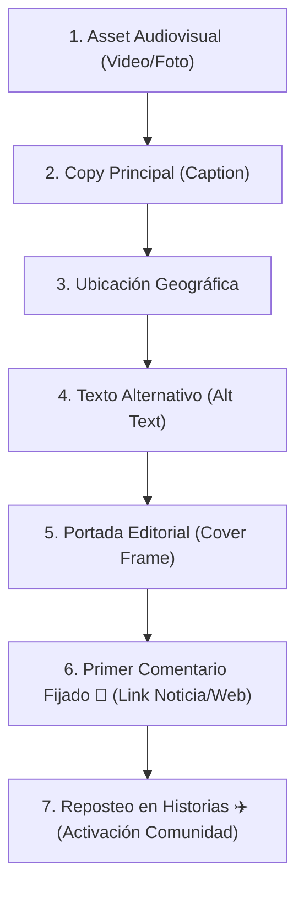

# 📱 Guía Operativa Maestra: Publicación de Contenido en Instagram (Colegio Waldorf Trekan)
**Estándar Canónico de Publicación para Redes Sociales y Admisión**  
*Documento operativo para el Equipo de Comunicaciones, Dirección y Asistentes de IA.*

---

## 🎯 El Objetivo del Esquema
En el Colegio Waldorf Trekan, ninguna pieza se publica de forma improvisada ni con la lógica estridente de la publicidad comercial tradicional. Todo contenido publicado en Instagram responde al estándar **"Refugio Evolutivo"** (bajar el cortisol, transmitir belleza y calma, y guiar a las familias suavemente hacia una conversación humana por WhatsApp).

Para garantizar que ningún detalle técnico se olvide (Alt Text, ubicación, portada, primer comentario fijado, hashtags locales y reshare en historias), se establece este **Protocolo Operativo Universal en 7 Elementos**.

---

## 📦 El Paquete Canónico de 7 Elementos (Checklist de Entrega)

Cada vez que el equipo o un agente de IA prepare una publicación (Reel, Carrusel o Foto), DEBE entregar la ficha completa con estos 7 elementos listos para copiar y pegar:

---

### Elemento 1: El Asset Audiovisual (Video o Foto)
* **Formato para Reels:** Vertical 9:16 (`1080 × 1920 px`).
* **Velocidad y Ritmo:** 24 a 30 fps (look cinematográfico). Tomas de 2.5 a 4 segundos.
* **Tipografía en Pantalla:** `Merriweather Bold` (la tipografía editorial oficial). Prohibidas las fuentes genéricas de TikTok o fuentes antroposóficas ilegibles en subtítulos móviles.
* **Zona Segura:** Dejar libres los 350 px inferiores y 150 px del lateral derecho para que los botones de Instagram no tapen los textos.
* **Audio:** Sonido ambiente real del colegio (ASMR: crujido de madera, pájaros, risas de niños al 100%) + música acústica suave de fondo (`Calm Nature Glow`, guitarra o piano a -18 dB / 25-30% de volumen).

---

### Elemento 2: Copy Principal (Caption)
El texto de la publicación sigue la **Fórmula Waldorf de Reducción de Cortisol**:
1. **Hook Reflexivo:** Pregunta o afirmación de desarrollo humano (ej. *"A los 11 años ocurre una transformación profunda..."*). Cero signos de exclamación (`¡!`) y frases de menos de 25 palabras.
2. **Hecho Real (Sin Ficción):** Descripción de lo vivido (ej. Encuentro en San Felipe, amasado de pan, huerta). Sin exageraciones ni neuromitos.
3. **Cierre Poético / Fraterno:** Síntesis del sentido profundo del colegio.
4. **Llamado a la Acción Suave (CTA):** Invitación a conversar por WhatsApp o visitar la web (`Enlace en nuestra biografía`). Nunca *"¡Últimos cupos, corre ya!"*.
5. **Métrica Rey (Estímulo al DM):** Frase orientada a compartir: *"Envíale este video a una familia que esté buscando una educación respetuosa y con sentido."* (Los envíos por DM pesan 3 a 5 veces más que un like en el algoritmo de Meta).
6. **Límite Estricto de Hashtags (Regla 2026):** Entre **3 y 5 hashtags** específicos y locales (ej. `#PuertoVaras #PedagogiaWaldorfChile #EducacionAlternativa #ColegioWaldorfTrekan #SurDeChile`). Prohibido usar más de 5 o hashtags genéricos masivos como `#Educacion`.

---

### Elemento 3: Ubicación Geográfica Obligatoria
* **Valor:** Siempre seleccionar **`Puerto Varas, Chile`**.
* **Motivo:** Ancla el contenido al clúster geolocalizado de familias y madres de la cuenca del Lago Llanquihue, evitando que Meta disperse las impresiones en otras regiones.

---

### Elemento 4: Texto Alternativo (Alt Text para SEO y Accesibilidad)
* **Dónde se ingresa:** En la pantalla previa a publicar: `Configuración avanzada` → `Escribir texto alternativo`.
* **Formato:** Descripción literal, descriptiva y accesible de la escena, incluyendo palabras clave naturales (ej. *"Estudiantes de 5° básico del Colegio Waldorf Trekan de Puerto Varas conviviendo y corriendo al aire libre durante el Encuentro Nacional de Pentatlón Waldorf en San Felipe."*).
* **Beneficio:** Alimenta el algoritmo de reconocimiento visual de Meta y posiciona el post en búsquedas temáticas.

---

### Elemento 5: Portada Editorial (Cover Frame)
* **Regla de Oro:** La portada debe verse como una revista de arte o naturaleza (*Kinfolk* / *Patagonia*), nunca como un flyer escolar.
* **Selección del fotograma:** Elegir un segundo del video donde los niños estén de espaldas, caminando en la naturaleza o en un plano detalle de manos trabajando materia noble (ej. a los 0:15).
* **Prohibido:** Niños mirando forzadamente a cámara o textos chillones cortados en la grilla del perfil (1:1).

---

### Elemento 6: Primer Comentario Fijado 📌 (El Link a la Web)
* **Por qué no en el caption:** Los enlaces en el texto de Instagram no son clickeables. Poner URLs largas en el caption ensucia la lectura.
* **Ejecución:** Apenas se publica el Reel, la cuenta `@waldorftrekanpv` comenta de inmediato el enlace a la crónica o noticia web:
  > *📖 Lee la crónica completa sobre la época de la Grecia Clásica y los fundamentos pedagógicos de la Pentatlón en nuestra web:*  
  > *👉 www.colegiowaldorftrekan.cl/noticias*
* **Acción obligatoria:** Mantener presionado el comentario y tocar **"Fijar comentario" (Pin 📌)** para que quede permanentemente en la parte superior.

---

### Elemento 7: Reposteo Circular en Historias ✈️
* **Para quién es:** Mientras el Reel atrae a familias nuevas que no nos siguen, las Historias notifican a la comunidad actual de seguidores (familias matriculadas y simpatizantes).
* **Ejecución:**
  1. En el Reel publicado, tocar el **avioncito de papel ✈️**.
  2. Seleccionar **"Agregar reel a tu historia"**.
  3. Añadir un sticker de texto minimalista con el tono de voz de Trekan:
     > *Hito 5° básico en San Felipe 🌿 Toca para ver el video completo*
  4. Publicar en Historias.

---

## 🛠️ Resumen de Flujo para el Operador (Checklist de 3 Minutos)

| Paso | Acción en el Teléfono | Tiempo estimado |
| :---: | :--- | :---: |
| **1** | Abrir Instagram → Botón `+` → Seleccionar **Reel** → Elegir archivo exportado. | 30 seg |
| **2** | Pegar el **Copy Principal** (Elemento 2). | 20 seg |
| **3** | Ajustar **Portada** en el segundo indicado (Elemento 5). | 15 seg |
| **4** | Añadir **Ubicación:** `Puerto Varas, Chile` (Elemento 3). | 10 seg |
| **5** | Ir a `Configuración avanzada` → Pegar **Alt Text** (Elemento 4). | 20 seg |
| **6** | Presionar **Compartir** azul. | 15 seg |
| **7** | Abrir comentarios del Reel → Pegar **Primer Comentario** → **Fijar 📌** (Elemento 6). | 20 seg |
| **8** | Tocar avioncito ✈️ → **Agregar a tu historia** → Pegar texto de historia (Elemento 7). | 30 seg |
| **Total** | **Proceso completo, profesional y blindado.** | **~2.5 min** |

---

## 📅 Protocolo Estratégico de Secuencia, Amplificación y Cadencia Editorial

### 1. Secuencia Obligatoria de Formatos (Anti-Canibalización)
* **El Carrusel va PRIMERO:** Establece la memoria fotográfica oficial, el detalle narrativo y activa la doble oportunidad de impresión en el feed de Meta.
* **El Reel va 24 a 48 horas DESPUÉS:** Actúa como la segunda ola de alcance orgánico hacia no-seguidores en la pestaña Reels/Explorar, evitando competir y canibalizar la atención en el mismo día.

### 2. Ritual Operativo de Amplificación (Los Primeros 15 Minutos)
1. **Minuto 1:** Fijar el **Primer Comentario 📌** con la URL directa a la web/noticia.
2. **Minuto 3:** Repostear a **Historias con el avioncito ✈️** usando sticker de ubicación (`Puerto Varas, Chile`) y CTA al carrusel.
3. **Minuto 10:** Inyectar el enlace en los **grupos de WhatsApp de apoderados / comunidad** para generar tracción social inmediata y comentarios tempranos.
4. **Primera hora:** Responder con calidez a cada comentario para indicarle al algoritmo de Meta que la conversación está viva.

### 3. Cadencia Editorial Sostenible (Ritmo Sano High-End)
* **2 publicaciones fuertes en el feed por semana** (1 Carrusel pedagógico/documental + 1 Reel de experiencia viva en movimiento).
* **2 a 3 historias espontáneas semanales** (detalles cotidianos: luz en la sala, panes, huerta, naturaleza).

