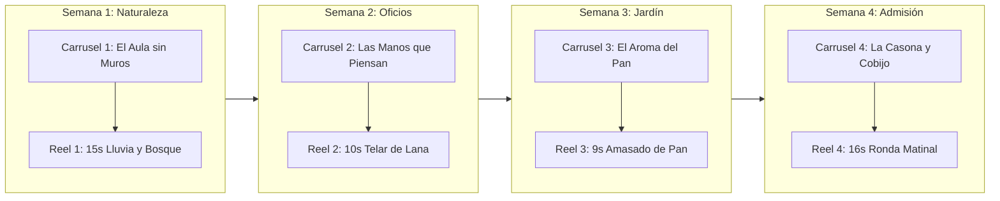

# 🌲 PLAN DE CAMPAÑA INSTAGRAM — MES 1: «EL RITMO DE LA INFANCIA»
## Colegio Waldorf Trekan — Puerto Varas (Parque Ivian)

---

## 🧭 1. ESTRATEGIA Y REGLAS DE CRECIMIENTO ORGÁNICO (META 2026)

> [!IMPORTANT]
> **La Métrica Rey: Envíos por DM (Shares)**
> El algoritmo de Meta premia los contenidos que los padres envían a otros padres por mensaje privado (pesa de 3 a 5 veces más que un like o comentario). 
> Todos los llamados a la acción de fase ToFu se enfocan en compartir: *«Envíale esto a una familia que busque una educación más humana y en contacto con la tierra»*.

### Invariantes Operativos de Publicación
1. **Secuencia Anti-Canibalización**: 
   * **Miércoles (18:30 hrs)**: Carrusel Pedagógico/Documental (activa doble impresión en el feed).
   * **Viernes (19:00 hrs, 48h después)**: Reel en movimiento (activa alcance orgánico a no-seguidores en la pestaña Reels/Explorar).
2. **Ritual de los Primeros 15 Minutos**:
   * *Minuto 1*: Fijar el **Primer Comentario 📌** con el enlace limpio a la web (`colegiovaldorftrekan.cl/admision`).
   * *Minuto 3*: Repostear a **Historias con el avioncito ✈️** usando sticker de ubicación (`Puerto Varas, Chile`) y CTA al post.
   * *Minuto 10*: Compartir el link en los grupos de WhatsApp de apoderados para activar comentarios tempranos.
   * *Primera hora*: Responder a cada comentario con calidez y tono comunitario.
3. **Hashtags Estrictos (Máximo 3 a 5 locales)**:
   * `#PuertoVaras` · `#ColegioWaldorfTrekan` · `#PedagogiaWaldorfChile` (cero hashtags globales genéricos como `#Educacion`).
4. **Configuración de Cuenta**: Categoría obligatoria: `Colegio` o `Escuela` (activa la geolocalización hacia padres locales).

---

## 📅 2. CALENDARIO EDITORIAL DEL MES (4 SEMANAS TEMÁTICAS)



| Semana | Eje Temático | Miércoles (Carrusel 10 slides) | Viernes (Reel 9:16) | Objetivo del Embudo |
| :---: | :--- | :--- | :--- | :--- |
| **S1** | **Naturaleza & Tierra** | «Por qué en el sur la lluvia no cancela la infancia» | `REEL_01` (15s bajo los coihues) | **ToFu**: Alcance, viralidad por DM y reducción de cortisol. |
| **S2** | **Oficios & Arte** | «Aprender a hilar para aprender a pensar: motricidad fina real» | `REEL_02` (10s hilando vellón) | **MoFu**: Autoridad pedagógica y valor curricular frente al sistema tradicional. |
| **S3** | **Jardín de Infancia** | «El pan de cada día: cómo la espera y los sentidos nutren al niño» | `REEL_04` (9s amasando pan integral) | **MoFu**: Marcador somático para familias con niños de 2 a 6 años. |
| **S4** | **Comunidad & Admisión** | «Una escuela fundada por familias: qué significa educar para la vida» | `REEL_05` (16s Ronda matinal y Casona) | **BoFu**: Conversión suave y tráfico directo al formulario de admisión. |

---

## 📦 3. ENTREGAS CANÓNICAS LISTAS PARA PUBLICAR (SEMANA 1)

### 🌿 PIEZA 1: CARRUSEL DOCUMENTAL (Miércoles 18:30 hrs)

#### 1. Archivos y Formato
* **Selección de Activos**: 7 imágenes en alta resolución desde `⭐ 00_SELECCION_ELITE_CALIDAD_MAXIMA/02_FOTOS_EDITORIALES/`:
  * *Slide 1 (Portada)*: `FOTO_33_NATURALEZA_PARQUE_720x1280_...photo_16277_0.jpg`
  * *Slide 2*: `FOTO_34_NATURALEZA_PARQUE_960x1280_...photo_16267_0.jpg`
  * *Slide 3*: `FOTO_35_NATURALEZA_PARQUE_960x1280_...photo_16266_0.jpg`
  * *Slide 4*: `FOTO_36_NATURALEZA_PARQUE_960x1280_...photo_16270_0.jpg`
  * *Slide 5*: `FOTO_37_NATURALEZA_PARQUE_720x1280_...photo_16279_0.jpg`
  * *Slide 6*: `FOTO_38_NATURALEZA_PARQUE_720x1280_...photo_16282_0.jpg`
  * *Slide 7 (Cierre)*: `FOTO_40_NATURALEZA_PARQUE_720x1280_...photo_16235_0.jpg`
* **Proporción**: 4:5 o 9:16 vertical continuo sin bordes artificiales.

#### 2. Copy Principal (Caption)
```text
En el sur de Chile aprendemos algo desde pequeños: no hay mal tiempo si la ropa es la adecuada. 🌧️🌲

Mientras el mundo apura a los niños a permanecer sentados frente a pantallas luminosas, en Parque Ivian las botas de agua, el olor a tierra húmeda y las hojas de los coihues son parte viva del aula cotidiana.

El movimiento libre al aire libre no es una pausa entre materias; es la base biológica sobre la cual se construye la atención, el equilibrio y la salud integral de la infancia. 

Cuando un niño trepa un tronco o siente la llovizna en el rostro, no solo está jugando: está desarrollando la confianza en su propio cuerpo para toda la vida.

Enviamos un saludo fraterno a todas las familias que eligen criar con tiempo, naturaleza y cobijo. 🌿

Envíale esto a una mamá o papá que busque una infancia más conectada con la tierra. 💌

#PuertoVaras #ColegioWaldorfTrekan #PedagogiaWaldorfChile
```

#### 3. Ubicación Geográfica
`Puerto Varas, Chile`

#### 4. Texto Alternativo (Alt Text)
```text
Niños con botas y ropa impermeable explorando senderos naturales entre árboles nativos y hojas húmedas en el bosque del Colegio Waldorf Trekan en Parque Ivian, Puerto Varas.
```

#### 5. Portada Editorial
* Fotograma limpio de `FOTO_33` (composición natural, encuadre equilibrado, sin poses forzadas).

#### 6. Primer Comentario Fijado 📌
```text
Conoce nuestra propuesta pedagógica y el proceso de admisión en: https://www.colegiowaldorftrekan.cl/admision
```

#### 7. Texto para Historias ✈️
* **Texto**: *«Crecer con lluvia, bosque y tiempo. Desliza para ver la crónica completa en el feed 🌲»*
* **Sticker**: Ubicación `Puerto Varas, Chile` + Enlace al post.

---

### 🎬 PIEZA 2: REEL EXPERIENCIA VIVA (Viernes 19:00 hrs — 48h después)

#### 1. Archivo y Formato
* **Ruta del Video**:
  `~/Downloads/BANCO_MEDIOS_TREKAN_OFICIAL/⭐ 00_SELECCION_ELITE_CALIDAD_MAXIMA/01_VIDEOS_DESTACADOS/REEL_01_720x1280_15s_16369_file_16369_0.mp4`
* **Resolución**: 720×1280 (9:16 vertical nativo).
* **Duración**: 15.2 segundos.
* **Audio**: Ambiente natural (lluvia/viento al 100%) + pista instrumental suave de fondo a -22 dB.

#### 2. Copy Principal (Caption)
```text
15 segundos de silencio y bosque nativo en el sur. 🍃

La infancia no necesita ser acelerada. Necesita cobijo, ritmo y el crujir de las ramas bajo los pies.

En el Colegio Waldorf Trekan, la naturaleza no es un contenido en un libro: es el entorno vivo que acoge el crecimiento de nuestros niños cada mañana.

Respira profundo. Que tengas un reparador fin de semana en familia. 🌲

Compártelo con alguien que necesite un minuto de calma hoy. 🕊️

#PuertoVaras #ColegioWaldorfTrekan #PedagogiaWaldorfChile
```

#### 3. Ubicación Geográfica
`Puerto Varas, Chile`

#### 4. Texto Alternativo (Alt Text)
```text
Video vertical de 15 segundos que muestra la serenidad de los senderos boscosos de Parque Ivian y la naturaleza viva del Colegio Waldorf Trekan en Puerto Varas.
```

#### 5. Portada Editorial
* Fotograma en el segundo `00:03` (toma despejada del claro de bosque y luz natural filtrada).

#### 6. Primer Comentario Fijado 📌
```text
Abierto el proceso de Admisión para Jardín de Infancia y Enseñanza Básica. Más información en: https://www.colegiowaldorftrekan.cl/admision
```

#### 7. Texto para Historias ✈️
* **Texto**: *«Una pausa de 15 segundos en el bosque de Parque Ivian. Nuevo reel en el perfil 🍃»*
* **Sticker**: `Puerto Varas, Chile`.

---

## 🛠️ 4. INTEGRACIÓN DE MOTORES DE AGENCIA (OpenMontage, openmotion, rea-video)

Si se desea potenciar piezas futuras con las herramientas avanzadas del stack:
1. **OpenMontage (`cd ~/Documents/GitHub/OpenMontage`)**:
   * Ideal para renderizar Video Ads con guion programático en Remotion. 
   * Permite inyectar las fotos editoriales con transiciones lentas (*crossfade* de 1.4s), música en 432 Hz y tipografía editorial `Merriweather`, exportando directamente a `1080x1920` sin requerir edición manual en Premiere/CapCut.
2. **openmotion (`cd ~/Documents/GitHub/openmotion`)**:
   * Para animar citas pedagógicas de Rudolf Steiner o textos de época en canvas/SVG cinemático para la web o pantallas de presentación.
3. **rea-video (`cd ~/Documents/GitHub/rea-video`)**:
   * Para auditar nuevos videos crudos de eventos escolares (ej. Pentatlón o fiestas del año), recortando pausas innecesarias y estabilizando el encuadre vertical automáticamente.

---
*Compilado por Antigravity para Felipe Vivanco y el equipo de comunicaciones de Trekan.*
